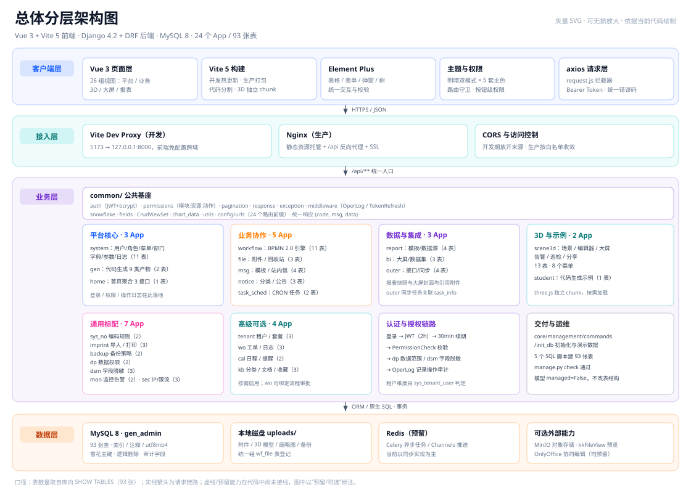
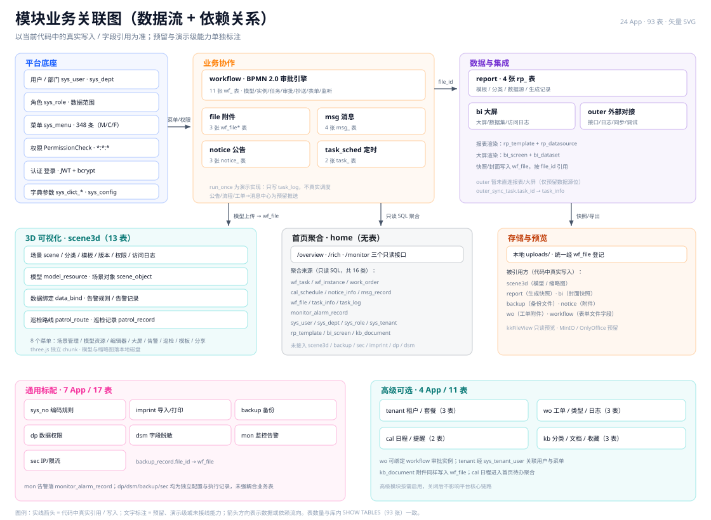
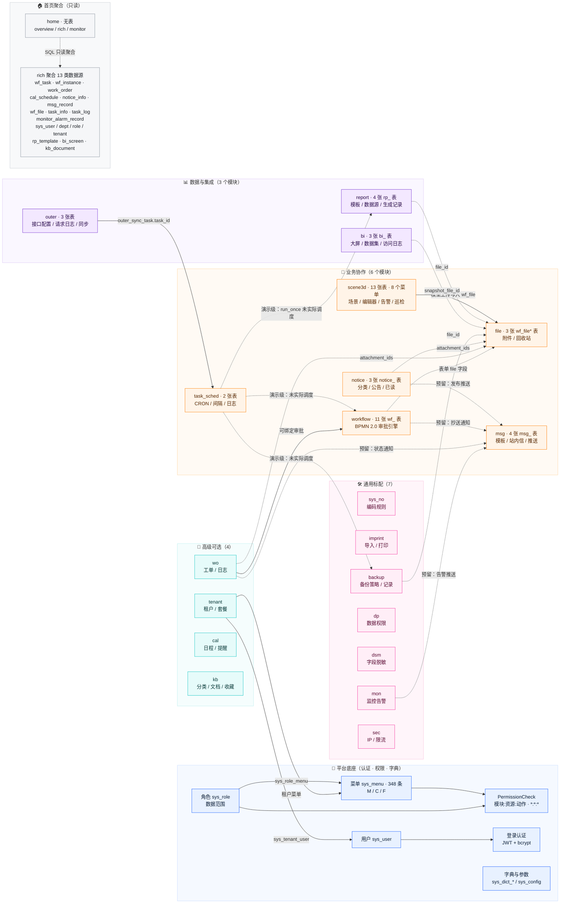
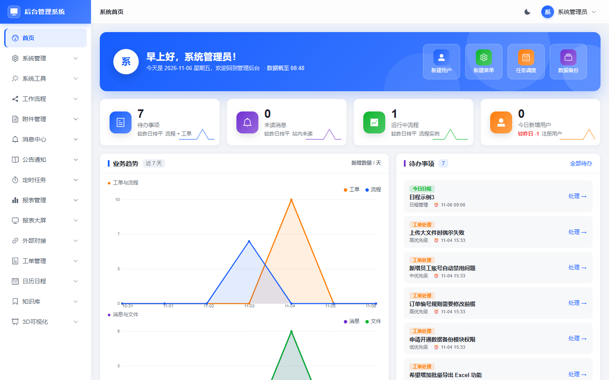
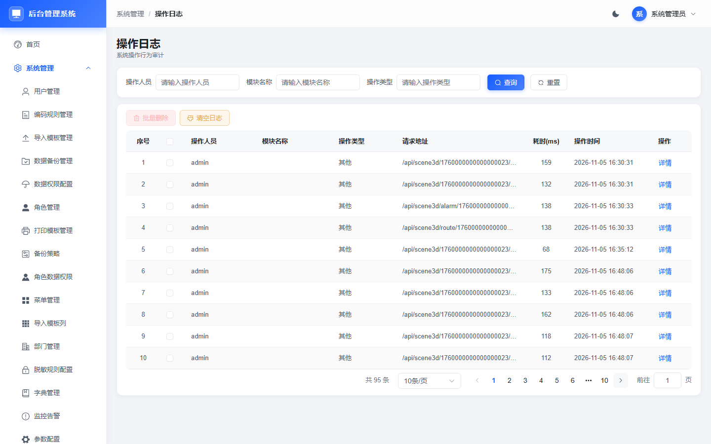
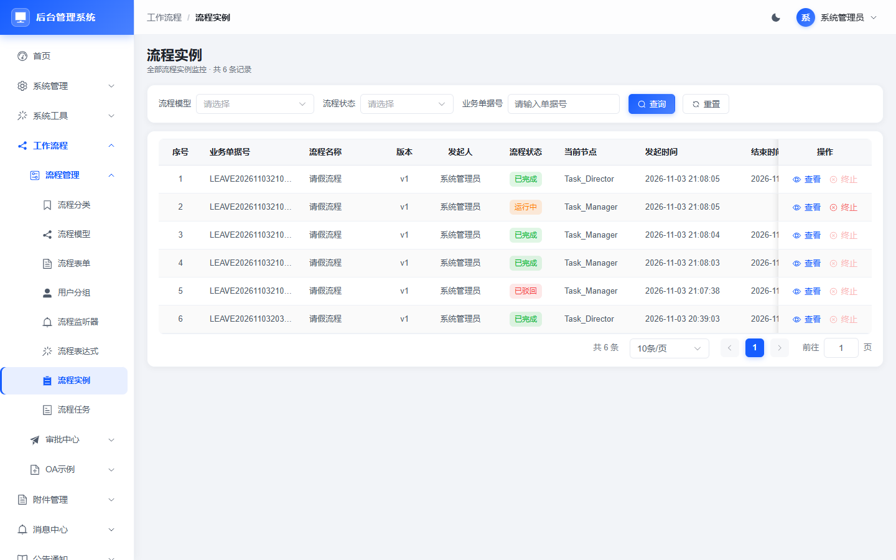
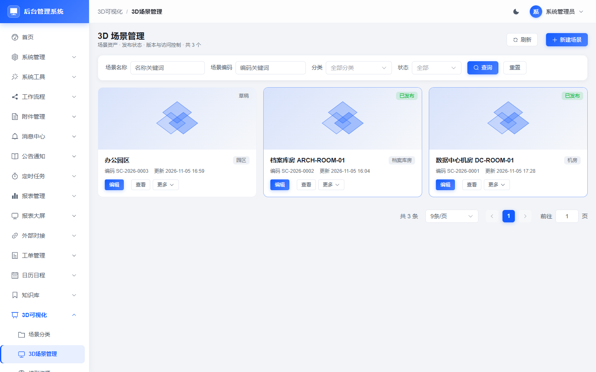
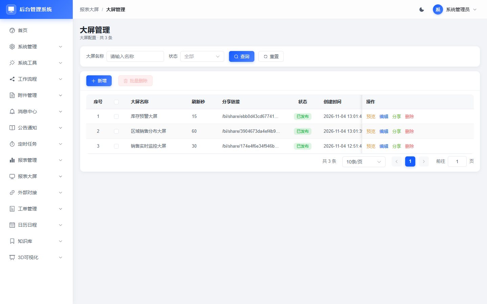
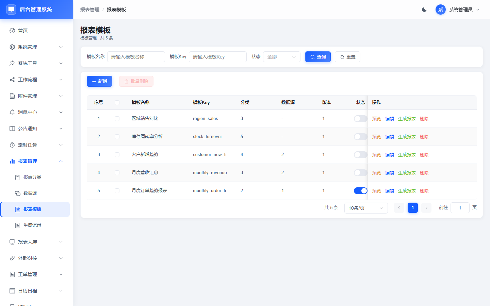

# 后台管理系统

**简体中文** | [English](#english)

[](https://www.python.org/)
[](https://www.djangoproject.com/)
[](https://vuejs.org/)
[](https://element-plus.org/)
[](https://www.mysql.com/)

一个基于 **Django 4.2 + DRF + MySQL 8 + Vue 3 + Element Plus** 的后台管理系统。
内置完整的平台基础模块（用户、角色、菜单、部门、字典、参数、日志）、**代码生成器**（读表 → 配置 → 预览/下载 → 自动注册菜单）与**工作流审批模块**（BPMN 2.0 流程设计、流程发起、待办审批、抄送与流程轨迹）。

---

## 系统架构图

> 💡 下图使用**矢量 SVG**（文字不糊、可无损放大，不受浏览器缩放影响），并附 **4480px 宽高清 PNG** 备份；Mermaid 源码保留在折叠区，便于二次编辑。图后附关系说明。
>
> 📐 **独立架构图（11 张，可直接在浏览器打开）**：[总体分层架构图](docs/架构图/10-总体分层架构图.svg) · [模块业务关联图](docs/架构图/11-模块业务关联图.svg) · [系统架构图](docs/架构图/01-系统架构图.svg) · [全功能结构图](docs/架构图/02-全功能结构图.svg) · [运行效果示意图](docs/架构图/03-运行效果示意图.svg) · [数据库关系图](docs/架构图/04-数据库关系图.svg) · [部署拓扑图](docs/架构图/05-部署拓扑图.svg) · [数据链路流程图](docs/架构图/06-数据链路流程图.svg) · [告警生命周期图](docs/架构图/07-告警生命周期图.svg) · [仿真时序图](docs/架构图/08-仿真时序图.svg) · [版本路线图](docs/架构图/09-版本路线图.svg)

### 总体分层架构（四层 · 24 个 App · 93 张表）



> 高清位图备份：[10-总体分层架构图.png](docs/架构图/10-总体分层架构图.png)（4480 × 3200，适合投屏 / 打印）

```mermaid
flowchart TB
    subgraph Client["🖥️ 客户端层"]
        direction LR
        FE["Vue 3 + Vite 5<br/>Element Plus 业务组件"]
        THEME["主题令牌<br/>明暗双模式 × 5 套主色"]
        PAGES["26 组页面<br/>平台 / 业务 / 3D / 大屏"]
        VIEWER["3D 查看器<br/>three.js 独立 chunk"]
    end

    subgraph Gateway["🌐 接入层"]
        direction LR
        NGINX["Nginx<br/>静态资源 / SSL / 代理"]
        VITE["Vite Dev Proxy<br/>5173 → 8000"]
    end

    subgraph Backend["⚙️ 业务层 · Django 4.2 + DRF · 24 个 App · 93 张表"]
        direction TB
        subgraph Common["📦 公共基座 common/"]
            direction TB
            ROUTER["config/urls.py<br/>24 个路由前缀"]
            RESP["统一响应<br/>{code, msg, data}"]
            JWT["JWT + bcrypt<br/>2h Token · 30min 续期"]
            RBAC["PermissionCheck<br/>模块:资源:动作"]
            CRUD["CrudViewSet<br/>雪花 ID / 逻辑删除 / 审计"]
            LOG["OperLogMiddleware<br/>操作日志"]
        end

        subgraph Core["🏛️ 平台核心（3）"]
            direction TB
            SYS["system<br/>用户 / 角色 / 菜单 / 部门<br/>字典 / 参数 / 日志"]
            GEN["gen<br/>代码生成器（生成 biz_student 示例）<br/>9 个产物 + ZIP"]
            HOME["home<br/>首页聚合<br/>overview / rich / monitor"]
        end

        subgraph Biz["🧩 业务模块（9）"]
            direction TB
            WF["workflow<br/>BPMN 2.0 引擎 · 11 表"]
            FILE["file<br/>附件 / 回收站 · 3 表"]
            MSG["msg<br/>模板 / 站内信 · 4 表"]
            NOTICE["notice<br/>分类 / 公告 · 3 表"]
            TASK["task_sched<br/>CRON / 日志 · 2 表"]
            REPORT["report<br/>模板 / 生成 · 4 表"]
            BI["bi<br/>大屏 / 数据集 · 3 表"]
            OUTER["outer<br/>接口 / 同步 · 3 表"]
            SCENE["scene3d<br/>3D 场景 · 13 表 · 8 菜单"]
        end

        subgraph Std["🛠️ 通用标配（7）"]
            direction TB
            NO["sys_no<br/>编码规则"]
            IMPRINT["imprint<br/>导入 / 打印"]
            BACKUP["backup<br/>备份策略 / 记录"]
            DP["dp<br/>数据权限"]
            DSM["dsm<br/>字段脱敏"]
            MON["mon<br/>监控告警"]
            SEC["sec<br/>IP 黑白 / 限流"]
        end

        subgraph Adv["🎯 高级可选（4）"]
            direction TB
            TENANT["tenant<br/>多租户 / 套餐"]
            WO["wo<br/>工单流转"]
            CAL["cal<br/>日历日程"]
            KB["kb<br/>知识库"]
        end
    end

    subgraph Infra["🗄️ 数据与基础设施"]
        direction LR
        MYSQL[("MySQL 8.0.21<br/>gen_admin · 93 表 / 1300 行")]
        DISK["本地磁盘 uploads/<br/>附件 / 3D 模型 / 备份"]
        REDIS["Redis<br/>预留：Celery / Channels"]
        MINIO["MinIO<br/>预留：对象存储"]
        KK["kkFileView<br/>可选：只读预览"]
        OO["OnlyOffice<br/>预留：协同编辑"]
    end

    ROUTER ~~~ SYS
    SYS ~~~ WF
    WF ~~~ NO
    NO ~~~ TENANT
    TENANT ~~~ MYSQL

    FE --> THEME
    FE --> PAGES
    PAGES --> VIEWER
    PAGES --> NGINX
    PAGES --> VITE
    NGINX --> ROUTER
    VITE --> ROUTER
    ROUTER -.->|"按前缀分发到 24 个 App"| CRUD
    CRUD -->|"全 App 共用 ORM / 原生 SQL"| MYSQL
    HOME -.->|"只读聚合"| MYSQL
    SCENE -->|"3D 模型 / 缩略图"| DISK
    FILE -->|"附件落盘"| DISK
    FILE -.->|"预览地址"| KK
    FILE -.->|"预留"| MINIO
    FILE -.->|"预留"| OO

    classDef client fill:#e8f1ff,stroke:#165dff,color:#0b1f3a
    classDef gateway fill:#e6fbfa,stroke:#0fc6c2,color:#083b3a
    classDef common fill:#f3e8ff,stroke:#722ed1,color:#2b0b4d
    classDef core fill:#e8f1ff,stroke:#165dff,color:#0b1f3a
    classDef biz fill:#fff4e8,stroke:#ff7d00,color:#5c2a00
    classDef std fill:#ffeef7,stroke:#f5319d,color:#5c0a33
    classDef adv fill:#e6fbfa,stroke:#0fc6c2,color:#083b3a
    classDef infra fill:#f2f4f7,stroke:#4e5969,color:#1f2329

    class FE,THEME,PAGES,VIEWER client
    class NGINX,VITE gateway
    class ROUTER,RESP,JWT,RBAC,CRUD,LOG common
    class SYS,GEN,HOME core
    class WF,FILE,MSG,NOTICE,TASK,REPORT,BI,OUTER,SCENE biz
    class NO,IMPRINT,BACKUP,DP,DSM,MON,SEC std
    class TENANT,WO,CAL,KB adv
    class MYSQL,DISK,REDIS,MINIO,KK,OO infra

    style Client fill:#fbfdff,stroke:#c9ddff
    style Gateway fill:#f5fdfd,stroke:#bdeeee
    style Backend fill:#fdfdff,stroke:#d6d6f5
    style Common fill:#faf7ff,stroke:#dcc7f5
    style Core fill:#f5f9ff,stroke:#c9ddff
    style Biz fill:#fffaf4,stroke:#ffd6a3
    style Std fill:#fff5fa,stroke:#f9c3dd
    style Adv fill:#f5fdfd,stroke:#bdeeee
    style Infra fill:#f8f9fa,stroke:#c9cdd4
```

<details>
<summary>Mermaid 源码（点击展开）</summary>



</details>

### 模块业务关联图（数据流 + 依赖关系）



> 高清位图备份：[11-模块业务关联图.png](docs/架构图/11-模块业务关联图.png)（4480 × 3280）

<details>
<summary>Mermaid 源码（点击展开）</summary>



</details>

**图例与口径**

- **实线**：代码中真实写入或直接引用。例如 `apps/scene3d/views.py` 上传模型时写 `WfFile`；`outer_sync_task.task_id` 关联 `task_info`；`sys_tenant_user` 关联租户与用户。
- **虚线 + 预留**：数据库字段已留位、页面已呈现，但当前代码尚未接线（如公告/流程/工单/告警向消息中心的自动推送）。
- **虚线 + 演示级**：`task_sched` 的「立即执行」写死为“演示：未实际调度”，未真正驱动报表生成、备份或流程超时检测。
- **首页聚合**：`apps/home/views.py` 的 `rich` 接口以只读 SQL 汇总 13 类数据；未接入 `scene3d`、`backup`、`sec`、`imprint`、`dp`、`dsm`、`student`。
- **报表/大屏数据源**：`report` 走 `rp_datasource` 配置、`bi` 走 `bi_dataset`，当前渲染基于模板/数据集配置与演示数据；`outer` 尚未作为其数据源直连。
---

## 功能截图

> 以下 6 张为当前最新代码在 **1440×900、浅色 + 默认蓝主题**下截取的代表性页面，覆盖首页聚合、平台管理、工作流、3D 可视化、BI 大屏与报表管理。其余模块可直接登录后从左侧菜单进入查看，完整功能见 [项目功能详细说明](docs/项目文档/01-项目功能详细说明.md)。

| 首页 Dashboard（指标卡 / 趋势 / 待办 / 公告） | 系统管理 · 操作日志 |
|---|---|
|  |  |

| 工作流 · 流程实例 | 3D 可视化 · 场景管理 |
|---|---|
|  |  |

| 报表大屏 · 大屏管理 | 报表管理 · 报表模板 |
|---|---|
|  |  |

---

## 功能特性

- **认证与权限**：自研 JWT（Token 2 小时，剩余 30 分钟静默续期）、bcrypt 密码、按钮级权限 `v-perm`、后端 `PermissionCheck` 校验、`admin` 通配权限。
- **动态菜单与路由**：登录后由后端下发菜单树，前端动态注册路由；菜单类型支持目录（M）/页面（C）/按钮（F）。
- **平台基础模块**：用户管理（角色分配、重置密码、状态开关）、角色管理（分配菜单）、菜单管理、部门树、字典管理（类型 + 数据）、参数配置、操作日志、登录日志。
- **代码生成器**：读取 `information_schema` → 导入业务表 → 字段级配置（表单类型、查询方式、字典、列表/查询/必填/导入/导出）→ 预览 9 个产物 → DDL 查看 → ZIP 下载 → 自动注册菜单与按钮权限。
- **生成模块能力**：标准 CRUD、条件查询、分页、批量删除、Excel 模板下载、批量导入（错误行提示）、条件导出。
- **工作流审批**：`工作流程` 三级菜单（流程管理 / 审批中心 / OA 示例）。bpmn-js 可视化设计 BPMN 2.0 流程，节点可配置指定用户 / 角色 / 部门 / 用户分组 / 表达式审批人，支持串行、或签、会签、排他/并行网关、抄送、超时到期时间与监听器；流程发布按版本隔离，运行中实例锁定发起时版本；审批中心提供发起流程、我的流程（可撤回）、待办（同意/驳回/转审/加签/退回）、已办、抄送我的；内置 OA 请假示例（请假超过 3 天自动加签总监审批）。
- **附件管理**：本地/MinIO 双存储切换、MD5 秒传去重、分片上传与断点续传、kkFileView 只读预览（PDF/Office/图片/视频）、OnlyOffice 在线协同编辑、业务类型绑定、预览水印、有效期自动清理、回收站恢复/彻底删除、全操作日志。
- **消息中心**：模板管理（站内信/短信/邮件/Webhook 四渠道，变量占位符）、站内消息已读/未读、全部已读/删除、推送日志与失败重试、渠道开关、前端 WebSocket 实时红点提醒。
- **公告通知**：公告分类、多渠道发布、角色范围控制、置顶、有效期（自动下线）、已读追踪、附件绑定、发布后自动推送消息中心。
- **定时任务**：CRON 与固定间隔两种调度、手动立即执行一次、运行日志（状态/返回/异常/耗时）、失败自动重试、Celery 异步执行 + 内置过期附件清理 / BPMN 超时检测 / 报表定时生成 / 消息重试四模板。
- **报表管理**：低代码报表模板拖拽设计（lowcode-report）、MySQL 本地 + API 外部双数据源、模板版本与角色权限、手动/定时生成 Excel/PDF、自动存入附件管理、生成记录与在线预览下载、WebSocket 实时查询。
- **报表大屏**：大屏拖拽设计（datart）、折线/柱状/饼图/数字指标/表格/地图组件、MySQL/API 数据集、发布后生成分享链接+访问密码、自动刷新秒、快照归档至附件管理、访问日志。
- **外部对接**：外部 API 配置（GET/POST/PUT/DELETE、Header/Query/Token/Basic 鉴权）、连通性一键测试、完整请求日志（入参/返回/耗时/状态码/异常）、手动/定时同步任务拉取外部数据写入本地库，报表与大屏模块直接选用已配置接口作为数据源。
- **3D 可视化**：`3D可视化` 菜单（场景分类 / 3D 场景管理 / 场景编辑器 / 模型资源 / 数据绑定 / 告警联动 / 巡检路线 / 场景发布）。13 张 `scene3d_` 表；three.js 按需加载（独立 chunk）渲染可交互三维场景，支持对象增删、属性编辑、视角漫游、点击拾取与按名称生成机柜/服务器/空调/UPS/密集架等占位几何；数据绑定支持表字段 / API 双数据源与阈值配色，告警联动含规则、记录与确认流程，巡检路线按点位自动漫游并生成记录，场景发布生成免登录分享链接与访问日志，内置大屏聚合页；明暗主题与 5 套配色全部走 CSS 令牌。

### 2026-11 标配功能（6 App）

- **编码规则**：自定义编码前缀、流水号位数、重置周期（日/月/年/永不）、预览生成、12 条规则演示数据。
- **数据备份**：手动备份（全量/指定模块）、自动备份策略（CRON + 保留份数）、备份记录列表与下载、清理过期备份。
- **数据权限**：行级数据权限规则（本部门/本部门及以下/仅本人/自定义 SQL）、角色绑定权限规则，列表查询自动生效。
- **字段脱敏**：脱敏规则（手机号/身份证/邮箱/银行卡等 10 种内置算法）、字段绑定脱敏规则、按角色控制是否显示原文。
- **安全策略**：IP 黑白名单、登录失败锁定（5 次/15 分钟）、接口限流（滑动窗口）、三条安全规则演示数据。
- **系统监控**：告警规则（CPU/内存/磁盘/API 响应时间）、告警记录、触发消息中心通知。

### 2026-11 高级功能（4 App）

- **多租户**：租户管理、租户套餐（功能模块勾选）、租户用户隔离、套餐到期自动锁定。
- **工单流转**：工单类型配置、工单全生命周期（创建 → 指派 → 处理 → 解决 → 关闭）、支持关联工作流审批、工单日志与消息通知；提供「工单列表」与「我的工单（我创建的 / 我处理的）」两个页面。
- **日历日程**：月/周/日三种视图、重复规则（每日/每周/每月/自定义间隔）、提醒设置（提前 N 分钟 + 多渠道）、日程提醒记录管理，演示数据 8 条。
- **知识库**：分类树（el-tree）、文档（Markdown + 富文本两种编辑模式）、收藏、浏览量统计、搜索；文档列表顶部提供总数 / 今日新增 / 已发布 / 累计阅读统计。

### 首页 Dashboard

- **聚合接口**：新增 `GET /api/home/rich/`（`apps/home/views.py`），一次返回趋势、待办、公告/消息、工作流、文件、任务、告警、用户组织、报表/BI、知识库、日程等 14 个数据块；保留既有 `overview` / `monitor` 结构不变。
- **布局**：修复 `.panel` 作为 flex 子项按内容收缩导致的横向空洞（栅格列 `display:flex`、面板 `width:100%; min-width:0`），同行卡片等高；1440 / 1280 实测无横向溢出与明显空洞。
- **内容**：渐变 Hero（问候 + 数据更新时间 + 4 快捷入口）→ 4 指标卡（待办 / 未读消息 / 运行中流程 / 今日新增用户，含真实 7 日迷你趋势与环比）→ 业务趋势（工单/流程、消息/文件）与待办 → 公告/站内消息/工作流 → 系统监控/文件存储/定时任务 → 告警/报表与 BI/知识库 → 今日日程（含未来 7 天）/用户与组织/运维速览 → 按「系统管理 / 业务协作 / 数据可视化 / 平台运维」分组的 24 格常用功能。
- **数据**：全部来自真实业务表；无数据的模块渲染「引导卡」（用途说明 + 跳转入口），不使用占位图或 mock。
- **图表**：新增纯 SVG 组件 `TrendChart` / `DistributionBar`，颜色统一取 `--chart-1..6`，随明暗模式与 5 套主题色联动，不新增第三方图表依赖。
- 详见 `docs/需求6 django-base-admin系统首页需求文档.md` 的「实现状态（V2）」与 `docs/设计稿或截图/首页改版设计/spec.md`。

### UI 主题与设计规范

- **明暗双模式**：浅色 / 深色一键切换，同时覆盖 Element Plus 与 Arco Design 组件；暗色下统一收敛边框、表面与文字对比度。
- **5 套主题色**：深海蓝 `#165dff`（默认）、青碧绿 `#0fc6c2`、幻夜紫 `#722ed1`、活力橙 `#ff7d00`、玫瑰红 `#f5319d`，每套自带 6 色图表色板。
- **切换方式**：顶栏右侧「主题设置」（太阳/月亮图标）→ 面板内选择外观模式与主题色，切换即时生效；选择写入 `localStorage["app-theme"]`（`{ mode, palette }`），刷新后自动恢复且首屏不闪烁。
- **设计令牌**：`frontend/src/styles/tokens.css` 统一定义 `--app-*`（文本 / 表面 / 边框 / 圆角 / 间距 / 字号 / 阴影 / 表格密度 / 状态色）、`--brand-*`（主色派生）与 `--chart-1..6`；主题运行时 `frontend/src/theme/index.js` 将主色写入 `--el-color-primary`、`--primary-1..10` 等变量，页面不写死颜色。
- **组件策略**：业务控件沿用 Element Plus；顶栏主题面板按需引入 Arco Design Vue（`Popover / RadioGroup / Radio`）；表格、弹窗、分页、表单、标签由全局样式一次换肤。

### 数据与展示约定

- **雪花主键**：所有数据表 `id` 为 `BIGINT`，数据库不使用 `AUTO_INCREMENT`，统一由后端 `common/snowflake.py` 生成；模型字段使用 `common/fields.py` 的 `SnowflakeIDField`。
- **列表序号**：所有列表页第一列为「序号」列，分页内升序，不展示主键 `id`。
- **标题一致**：列表页左上角标题与 `sys_menu.menu_name` 保持一致。
- **操作列**：多按钮操作列统一 `class-name="op-col"`，全局样式保证按钮单行不换行。

---

- **工程规范**：统一响应 `{code, msg, data}`（HTTP 状态恒 200）、统一分页、全局异常处理、逻辑删除 `is_deleted`、操作日志中间件、`managed=False` 的 SQL-first 表结构、Element Plus 业务组件 + Arco Design Vue 主题面板、CSS 设计令牌驱动明暗模式与多主题。
- **中英文文档**：本 README 提供中英文切换，`docs/` 下提供结构图、功能说明、运行部署与零基础学习路线。

## 技术栈

| 层 | 技术 | 说明 |
|---|---|---|
| 后端 | Django 4.2 + Django REST Framework | `ViewSet` + 自定义路由，统一响应与全局异常 |
| 认证 | 自研 JWT + bcrypt | `Authorization: Bearer`，`X-Refresh-Token` 静默续期 |
| 数据库 | MySQL 8 | 表由 SQL 脚本创建，模型 `managed=False` |
| 前端 | Vue 3（Composition API）+ Vite 5 | 无 Pinia，使用 `reactive` 轻量状态 |
| UI | Element Plus 2.x + Arco Design Vue 2.59 | 业务控件用 Element Plus；顶栏主题面板按需引入 Arco；设计令牌统一明暗模式与 5 套主题色 |
| 工作流 | 自研 Python BPMN 引擎 + bpmn-js | 解析 BPMN XML、Token 流转、网关与审批人策略；前端 Modeler 设计 / Viewer 轨迹高亮 |
| 定时任务 | Celery + Redis Broker | CRON / 间隔调度、失败重试、手动触发，内置 4 个系统模板 |
| 消息推送 | Django Channels + Redis WebSocket | 站内消息实时推送、未读红点提醒；预留短信/邮件/Webhook 渠道 |
| 附件预览 | kkFileView + OnlyOffice | kkFileView 只读在线预览（PDF/Office/图片/视频）；OnlyOffice 在线协同编辑 |
| 低代码报表 | lowcode-report 前端引擎 | 拖拽设计中国式报表、分组/交叉/参数报表，后端 MySQL/API 双数据源 |
| BI 大屏 | datart | 可视化大屏画布，折线/柱状/饼图/数字指标/地图组件，分享链接+密码访问 |
| 对象存储（可选） | MinIO SDK | 默认本地磁盘，切换 `wf_file_config` 的 `file.storage.type=minio` 即可启用 |
| 路由/请求 | vue-router 4 + axios | 动态路由、请求/响应拦截器 |

## 目录结构

```
django-base-admin/
├─ backend/                 # Django 后端
│  ├─ manage.py             # 管理入口（runserver / init_db / check）
│  ├─ config/               # settings、全局路由、wsgi/asgi
│  ├─ common/               # JWT、权限、分页、响应、异常、中间件、通用 CRUD
│  ├─ apps/
│  │  ├─ system/            # 用户/角色/菜单/部门/字典/配置/日志/认证
│  │  ├─ gen/               # 代码生成器（引擎 + 模板）
│  │  ├─ home/              # 首页聚合接口：overview + rich + monitor（无表）
│  │  ├─ student/           # 生成模块示例（学生信息表）
│  │  ├─ workflow/          # 工作流：模型/实例/任务/引擎/监听器/菜单种子数据
│  │  ├─ file/              # 附件管理：上传/预览/配置/回收站
│  │  ├─ msg/               # 消息中心：模板/站内信/推送日志/渠道配置
│  │  ├─ notice/            # 公告通知：分类/公告/已读追踪
│  │  ├─ task_sched/        # 定时任务：任务信息/任务日志（Celery）
│  │  ├─ report/            # 报表管理：分类/数据源/模板/生成记录
│  │  ├─ bi/                # 报表大屏：大屏/数据集/访问日志
│  │  ├─ outer/             # 外部对接：接口配置/请求日志/同步任务
│  │  ├─ scene3d/           # 【需求7】3D 可视化：13 张表的模型/接口/菜单种子数据
│  │  │
│  │  ├─ sys_no/            # 【标配】编码规则：规则 + 流水号日志
│  │  ├─ imprint/           # 【标配】导入/打印模板：模板 + 列 + 打印
│  │  ├─ backup/            # 【标配】数据备份：备份记录 + 备份策略
│  │  ├─ dp/                # 【标配】数据权限：权限规则 + 角色数据权限
│  │  ├─ dsm/               # 【标配】字段脱敏：脱敏规则 + 字段 + 角色绑定
│  │  ├─ sec/               # 【标配】安全策略：IP 控制 + 登录尝试 + 限流
│  │  ├─ mon/               # 【标配】系统监控：告警规则 + 告警记录
│  │  │
│  │  ├─ tenant/            # 【高级】多租户：租户 + 用户 + 套餐
│  │  ├─ wo/                # 【高级】工单流转：工单类型 + 工单 + 日志
│  │  ├─ cal/               # 【高级】日历日程：日程 + 提醒
│  │  └─ kb/                # 【高级】知识库：分类 + 文档 + 收藏
│  └─ core/management/commands/init_db.py   # 建库建表与初始化数据
├─ frontend/                # Vue3 前端
│  └─ src/
│     ├─ router/            # 静态路由 + 动态路由（支持三级菜单）
│     ├─ store/auth.js      # 登录态、权限、菜单
│     ├─ utils/request.js   # axios 封装
│     ├─ layout/            # 侧边栏（三级菜单缩进）、导航栏、布局
│     ├─ components/workflow/  # 表单渲染、流程查看器、流程详情抽屉
│     └─ views/
│        ├─ dashboard/      # 【重写】首页 Dashboard：Hero + 4 指标卡 + 趋势/待办/公告/监控/报表/日程 + 分组常用功能
│        ├─ system/         # 用户/角色/菜单/部门/字典/配置/日志
│        ├─ gen/            # 代码生成器
│        ├─ workflow/       # 工作流：流程管理/审批中心/OA 示例
│        ├─ student/        # 生成模块示例
│        ├─ file/           # 附件管理
│        ├─ msg/            # 消息中心
│        ├─ notice/         # 公告通知
│        ├─ task/           # 定时任务
│        ├─ rp/             # 报表管理
│        ├─ bi/             # 报表大屏
│        ├─ outer/          # 外部对接
│        ├─ scene3d/        # 【需求7】3D 可视化：分类/场景/编辑器/模型/绑定/告警/巡检/发布大屏
│        │
│        ├─ sys_no/rule/                    # 【标配】编码规则
│        ├─ imprint/{template,column,print}/ # 【标配】导入/打印模板
│        ├─ backup/{record,strategy}/        # 【标配】数据备份
│        ├─ dp/{permission,role_perm}/       # 【标配】数据权限
│        ├─ dsm/rule/                       # 【标配】字段脱敏
│        ├─ sec/{ip,login_attempt,rate_limit}/ # 【标配】安全策略
│        ├─ mon/{rule,record}/               # 【标配】系统监控
│        │
│        ├─ tenant/{tenant,package}/         # 【高级】多租户
│        ├─ wo/{type,order}/                 # 【高级】工单流转
│        ├─ cal/schedule/                    # 【高级】日历日程（月/周/日）
│        └─ kb/{category,document}/          # 【高级】知识库（树 + 文档）
└─ docs/
   ├─ 00-文档导航.md          # 总入口：分类索引与推荐阅读路径
   ├─ 需求文档/               # 需求 1~7
   ├─ 项目文档/               # 功能/启动/中间件/接口/数据库/测试/运维/FAQ/术语/路线图 + 历史版与 3D 规格
   ├─ 架构图/                 # 01~09 SVG（系统架构、功能结构、ER、部署、链路、告警、时序、路线）
   ├─ 设计稿或截图/           # 界面截图（历史 17、README 最新 6、dashboard 6、ui 7）、3D 场景截图（50）、首页改版设计
   ├─ 数据库/                 # 实际库单文件导出（结构 + 数据）与导出说明
   ├─ 报告/                   # UI 验收、主题优化、前端注释报告
   └─ *.sql                   # 5 个建表脚本（92 张表）
```

## 快速开始

> 详细步骤见 [docs/项目文档/03-运行启动指南.md](docs/项目文档/03-运行启动指南.md)。

**1. 准备数据库**

```sql
CREATE DATABASE gen_admin DEFAULT CHARACTER SET utf8mb4 COLLATE utf8mb4_unicode_ci;
```

执行 `docs/后台管理系统-初始化建表SQL.sql` 创建系统表；修改 `backend/config/settings.py` 中的 `DATABASES` 连接信息。

**2. 启动后端**

```bash
cd backend
python -m venv venv
# Windows: .\venv\Scripts\activate    macOS/Linux: source venv/bin/activate
pip install -r requirements.txt
python manage.py init_db        # 初始化菜单/按钮权限/管理员密码（注意 SQL_FILE 路径）
python manage.py runserver 0.0.0.0:8000
```

**3. 启动前端**

```bash
cd frontend
npm install
npm run dev                     # http://localhost:5173，/api 自动代理到 8000
```

**4. 登录**

| 账号 | 密码 | 说明 |
|---|---|---|
| `admin` | `123456` | 超级管理员，拥有全部权限 |

**5. 附加模块初始化（首次部署必填）**

附加模块的 22 张扩展表与默认数据需要单独执行一次：

```bash
# 第一步：必须先导入附加模块表（init_db 只执行 4 个 SQL，不包含这 22 张表）
mysql -u root -p gen_admin < docs/additional_module_init.sql

# 第二步：执行初始化（建表 + 菜单/权限 + 各模块种子数据）
cd backend
python manage.py init_db
```

执行后登录，侧边栏将自动出现 **附件管理、消息中心、公告通知、定时任务、报表管理、报表大屏、外部对接** 7 个顶级菜单。

> 附加模块详情见 [docs/项目文档/03-附加模块清单.md](docs/项目文档/03-附加模块清单.md) 与 [docs/需求文档/需求3 django-base-admin附加模块需求说明书.md](docs/需求文档/需求3 django-base-admin附加模块需求说明书.md)。

## 文档索引

> 全部文档已按类别归档，以下链接均为仓库相对路径，可直接点开。总入口见 [docs/00-文档导航.md](docs/00-文档导航.md)。

### 架构图（[docs/架构图/](docs/架构图/)）

| 文件 | 内容 |
|---|---|
| [01-系统架构图.svg](docs/架构图/01-系统架构图.svg) | 客户端 / 接入 / 业务 / 数据四层架构与模块分组 |
| [02-全功能结构图.svg](docs/架构图/02-全功能结构图.svg) | 24 个应用、6 大功能簇与核心页面 |
| [03-运行效果示意图.svg](docs/架构图/03-运行效果示意图.svg) | 首页布局示意（标注「示意图」，非真实截图） |
| [04-数据库关系图.svg](docs/架构图/04-数据库关系图.svg) | 平台 / 工作流 / 3D / 业务核心表关系 |
| [05-部署拓扑图.svg](docs/架构图/05-部署拓扑图.svg) | 浏览器 / Nginx / Django / MySQL 与可选中间件 |
| [06-数据链路流程图.svg](docs/架构图/06-数据链路流程图.svg) | 请求 → 中间件 → 权限 → 视图 → ORM → 响应全链路 |
| [07-告警生命周期图.svg](docs/架构图/07-告警生命周期图.svg) | 规则 → 触发 → 记录 → 确认 → 闭环 |
| [08-仿真时序图.svg](docs/架构图/08-仿真时序图.svg) | 3D 场景编辑、发布、分享与访客访问时序 |
| [09-版本路线图.svg](docs/架构图/09-版本路线图.svg) | M1~M10 里程碑与后续规划 |
| [10-总体分层架构图.svg](docs/架构图/10-总体分层架构图.svg) | **高清重制**：客户端 / 接入 / 业务 / 数据四层、24 个 App 分组与表数量（README 首图） |
| [11-模块业务关联图.svg](docs/架构图/11-模块业务关联图.svg) | **高清重制**：File 引用方、Outer→任务、Home 聚合、预留/演示级能力（README 第二图） |

### 项目文档（[docs/项目文档/](docs/项目文档/)）

| 编号 | 文档 | 内容 |
|---|---|---|
| 01 | [项目功能详细说明](docs/项目文档/01-项目功能详细说明.md) | 模块 / 页面 / 接口 / 数据表 / 实现状态全览 |
| 02 | [项目启动运行指南](docs/项目文档/02-项目启动运行指南.md) | 环境、建库、初始化、启动、验证与自检清单 |
| 03 | [中间件配置与安装](docs/项目文档/03-中间件配置与安装.md) | Django 中间件、MySQL、预览/存储、Nginx、预留服务 |
| 04 | [接口文档](docs/项目文档/04-接口文档.md) | 24 个路由前缀、公共约定、各模块接口与示例 |
| 05 | [数据库设计与数据字典](docs/项目文档/05-数据库设计与数据字典.md) | 93 张表（实际库）的字段、类型、默认值、注释与关系 |
| 06 | [测试与验收清单](docs/项目文档/06-测试与验收清单.md) | 250 项接口回归、46 项 3D 用例、构建与巡检结果 |
| 07 | [运维手册](docs/项目文档/07-运维手册.md) | 巡检、日志、备份恢复、发布回滚、故障速查 |
| 08 | [常见问题解答](docs/项目文档/08-常见问题解答.md) | 启动、数据库、权限、功能、前端、3D、部署 FAQ |
| 09 | [术语表](docs/项目文档/09-术语表.md) | 架构、认证、数据、工作流、3D、前端、运维术语 |
| 10 | [开发路线图](docs/项目文档/10-开发路线图.md) | 已完成里程碑、短板、后续规划与技术债 |
| 附录 | [项目结构与调用关系](docs/项目文档/01-项目结构与调用关系.md) | 架构图、时序图、文件级调用矩阵、数据库关系 |
| 附录 | [功能说明文档（历史版）](docs/项目文档/02-功能说明文档.md) | 全部功能、接口清单、权限与业务规则 |
| 附录 | [运行启动指南（历史版）](docs/项目文档/03-运行启动指南.md) | 环境、建库、初始化、启动、验证、FAQ |
| 附录 | [附加模块清单](docs/项目文档/03-附加模块清单.md) | 22 张表字段、菜单树、前端页面、API 端点速查 |
| 附录 | [多平台部署指南](docs/项目文档/04-多平台部署指南.md) | Linux / Windows / Docker / 云平台部署 |
| 附录 | [Java 开发者零基础学习路线](docs/项目文档/05-Java开发者零基础学习路线.md) | Python/Django 与 Java/Spring 对照、读码计划 |
| 附录 | [独立部署中间件部署手册](docs/项目文档/django-base-admin独立部署中间件部署手册.md) | 中间件独立部署步骤 |
| 附录 | [3D 可视化实现规格](docs/项目文档/3D可视化实现规格.md) | 数据模型、接口契约、页面与主题令牌选型 |

### 需求文档（[docs/需求文档/](docs/需求文档/)）

| 编号 | 文档 |
|---|---|
| 需求 1 | [后台管理系统需求规格说明书](docs/需求文档/需求1%20后台管理系统需求规格说明书.md) |
| 需求 2 | [工作流审批模块需求文档](docs/需求文档/需求2%20django-base-admin工作流审批模块需求文档.md) |
| 需求 3 | [附加模块需求说明书](docs/需求文档/需求3%20django-base-admin附加模块需求说明书.md) |
| 需求 4 | [通用标配功能需求文档](docs/需求文档/需求4%20django-base-admin通用标配功能需求文档.md) |
| 需求 5 | [高级可选功能需求文档](docs/需求文档/需求5%20django-base-admin高级可选功能需求文档.md) |
| 需求 6 | [系统首页需求文档](docs/需求文档/需求6%20django-base-admin系统首页需求文档.md) |
| 需求 7 | [3D 可视化模块需求文档](docs/需求文档/需求7%20django-base-admin_3D可视化模块需求文档.md) |

### 报告与验收（[docs/报告/](docs/报告/)）

| 文档 | 内容 |
|---|---|
| [UI 验收报告](docs/报告/ui-acceptance-report.md) | 页面布局、明暗主题与响应式验收 |
| [UI 主题优化说明](docs/报告/ui-theme-optimization.md) | 令牌化、明暗模式与 5 套主题色改造 |
| [前端代码注释报告](docs/报告/frontend-code-comment-report.md) | 前端模块注释覆盖与说明 |

### 截图与设计（[docs/设计稿或截图/](docs/设计稿或截图/)）

| 目录 | 内容 |
|---|---|
| [界面截图](docs/设计稿或截图/界面截图/) | 历史 17 张 + README 最新 6 张（首页/操作日志/流程实例/3D 场景/BI/报表模板） |
| [界面截图/ui](docs/设计稿或截图/界面截图/ui/) | 主题面板、暗色角色、日历等 7 张高保真图 |
| [界面截图/dashboard](docs/设计稿或截图/界面截图/dashboard/) | 首页 1440/1280 明暗与配色 6 张 |
| [3D 场景截图](docs/设计稿或截图/3D场景截图/) | 3D 模块 50 张（8 菜单 + 只读/分享 + 主题矩阵） |
| [首页改版设计](docs/设计稿或截图/首页改版设计/) | 首页改版 `spec.md` 与 `tasks.md` |

### 数据库导出（[docs/数据库/](docs/数据库/)）

| 文件 | 内容 |
|---|---|
| [django-base-admin-full-20261105.sql](docs/数据库/django-base-admin-full-20261105.sql) | 单文件全库导出：93 张表 `DROP/CREATE` + 按依赖顺序的 `INSERT`（1300 行），密码类字段已脱敏 |
| [00-导出说明.md](docs/数据库/00-导出说明.md) | 导出时间、脱敏连接信息、每表行数、还原步骤与导入顺序 |

### 数据库脚本（[docs/](docs/)）

| 脚本 | 内容 |
|---|---|
| [后台管理系统-初始化建表SQL.sql](docs/后台管理系统-初始化建表SQL.sql) | 基础平台 13 张表 |
| [后台管理系统-工作流建表SQL.sql](docs/后台管理系统-工作流建表SQL.sql) | 工作流 11 张表 |
| [additional_module_init.sql](docs/additional_module_init.sql) | 附加模块 22 张表 |
| [new_features_init.sql](docs/new_features_init.sql) | 增强功能 33 张表 |
| [scene3d_init.sql](docs/scene3d_init.sql) | 3D 可视化 13 张表与演示数据 |

## 工作流审批使用流程

1. 进入 **工作流程 → 流程管理**，先维护流程分类、自定义表单、用户分组、监听器与表达式；
2. 新建流程模型并点击「设计」，在 bpmn-js 画布拖拽 BPMN 2.0 图，选中审批节点配置审批人、审批方式与超时时间；
3. 点击「发布」生成新版本；已运行实例继续使用发起时版本，互不影响；
4. 普通用户在 **审批中心 → 发起流程** 选择已发布模型，填写表单并提交；
5. 审批人在 **待办任务** 中同意 / 驳回 / 转审 / 加签 / 退回，可在详情抽屉查看审批轨迹、表单与流程图；
6. 抄送人在 **抄送我的** 查看只读流程并自动标记已读；**OA 示例 → 请假查询** 演示业务表单与流程联动。

## 代码生成器使用流程

1. 在 MySQL 中创建业务表；
2. 进入 **系统工具 → 代码生成**，点击「导入数据表」；
3. 在字段配置页调整表单类型、查询方式、字典、列表/查询/导入/导出等；
4. 「预览」查看 9 个生成文件，「DDL」查看建表语句；
5. 「下载」得到 ZIP，按包内 `README-部署说明.txt` 复制到 `backend/apps/` 与 `frontend/src/`；
6. 注册 `INSTALLED_APPS`、`config/urls.py`，重启后端并刷新菜单；
7. 新菜单出现，即可使用 CRUD、导入、导出与操作日志。

## 部署

支持 Linux（Nginx + Gunicorn + systemd）、Windows Server（Waitress + Nginx/IIS）、Docker / docker-compose，以及阿里云/腾讯云等云平台与对象存储/CDN 前端托管。完整配置与命令见 [docs/项目文档/04-多平台部署指南.md](docs/项目文档/04-多平台部署指南.md)。

## 许可

本项目仅用于学习与内部项目参考，未附带开源许可证文件；如需开源发布请自行补充 LICENSE。

---

<h1 id="english">English</h1>

[简体中文](#代码生成型后台管理系统) | **English**

# Code-Generating Admin System

An admin system built with **Django 4.2 + DRF + MySQL 8 + Vue 3 + Element Plus**. It ships with a complete platform foundation (users, roles, menus, departments, dictionaries, configs, logs), a **code generator** (read tables → configure → preview/download → auto-register menus), and a **workflow approval module** (BPMN 2.0 modeling, process start, to-do approvals, CC and process traces).

## Screenshots

> The following 6 screenshots were captured from the latest code at **1440×900, light mode with the default blue palette**, covering the dashboard, platform administration, workflow, 3D visualization, BI screens and reports. Other modules are available from the sidebar after signing in.

| Dashboard | System · Operation Log |
|---|---|
|  |  |

| Workflow · Process Instances | 3D Visualization · Scenes |
|---|---|
|  |  |

| BI · Screen Management | Reports · Report Templates |
|---|---|
|  |  |


## Features

- **Auth & permissions**: custom JWT (2-hour token, silent refresh when 30 minutes remain), bcrypt passwords, button-level `v-perm` directive, backend `PermissionCheck`, wildcard permission for `admin`.
- **Dynamic menus & routes**: menus are delivered by the backend after login and registered as Vue routes at runtime (directory / page / button types).
- **Platform modules**: users (role assignment, password reset, status toggle), roles (menu assignment), menus, department tree, dictionaries (types + data), system configs, operation logs, login logs.
- **Code generator**: inspect `information_schema` → import business tables → per-field configuration (form widget, query type, dictionary, list/query/required/import/export) → preview 9 artifacts → view DDL → download ZIP → auto-register menus and button permissions.
- **Generated module capabilities**: standard CRUD, conditional search, pagination, batch delete, Excel template download, batch import with row-level error messages, conditional export.
- **Workflow approvals**: a three-level `Workflow` menu (Process Management / Approval Center / OA Samples). Design BPMN 2.0 diagrams with bpmn-js; assign approvers by user, role, department, user group or expression; support serial, any-one and all-sign modes, exclusive/parallel gateways, CC, due-time and listeners. Publishing creates a new version while running instances stay on their start-time version. The Approval Center covers start, my processes (withdraw), to-do (approve/reject/transfer/add-sign/return), done and CC lists; a leave-request OA sample routes requests over 3 days to a director.
- **File & attachment management**: local disk / MinIO dual storage, MD5 instant-upload dedup, chunked upload with resume, kkFileView read-only preview (PDF/Office/images/video), OnlyOffice collaborative editing, business-type binding, preview watermark, expiry auto-clean, recycle bin with restore/permanent delete, full operation audit log.
- **Message center**: template management (4 channels: in-site/SMS/email/Webhook with variable placeholders), read/unread in-site messages, mark-all-read, push log with retry per channel, WebSocket real-time red-dot in header.
- **Announcements**: categories, multi-channel publish, role-based visibility scope, top-pin, effective time window (auto-offline), read tracking, attachment binding, auto-push to message center on publish.
- **Scheduled tasks**: Celery with Cron expression and fixed-interval modes, manual one-shot trigger, execution log (status/return/error/duration), auto-retry on failure, 4 built-in templates (expired file cleanup / BPMN timeout detection / report scheduled generation / message retry).
- **Report management**: low-code drag-and-drop designer (lowcode-report), MySQL + API dual data sources, template versioning and role permission, manual / scheduled Excel & PDF generation, auto-save to attachment module, generation records with kkFileView preview, WebSocket real-time queries.
- **BI dashboards**: drag-and-drop canvas (datart), line/bar/pie/number indicator/table/map components, MySQL/API datasets, shareable URL with access password, configurable auto-refresh seconds, snapshot archive, access log.
- **External integration**: external API config (GET/POST/PUT/DELETE, headers/query, Token/Basic auth), one-click connectivity test, full request log (params/response/duration/status/error), manual/scheduled sync tasks that pull external data into local tables; report and BI modules directly pick configured APIs as data sources.
- **UI themes & design tokens**: light/dark modes plus 5 palettes (deep blue, teal, purple, orange, rose); the top-bar theme switcher persists to `localStorage["app-theme"]`; `tokens.css` defines `--app-*` / `--brand-*` / `--chart-1..6` tokens that drive Element Plus, Arco Design and custom styles, so tables, dialogs, charts and dark-mode borders follow instantly.
- **Engineering conventions**: unified response `{code, msg, data}` (HTTP status always 200), unified pagination, global exception handler, logical delete `is_deleted`, operation-log middleware, SQL-first schema with `managed=False`, Element Plus business components + on-demand Arco Design Vue theme panel, design tokens for light/dark and multi-theme.
- **Bilingual docs**: this README supports Chinese/English switching; the `docs/` folder contains architecture, feature, run/deploy and beginner guides.

## Tech Stack

| Layer | Technology | Notes |
|---|---|---|
| Backend | Django 4.2 + Django REST Framework | `ViewSet` + hand-written routes, unified response & exceptions |
| Auth | Custom JWT + bcrypt | `Authorization: Bearer`, `X-Refresh-Token` silent renewal |
| Database | MySQL 8 | Schema created by SQL script, models use `managed=False` |
| Frontend | Vue 3 (Composition API) + Vite 5 | No Pinia; a lightweight `reactive` store |
| UI | Element Plus 2.x + Arco Design Vue 2.59 | Element Plus for business components; Arco imported on demand for the top-bar theme panel; design tokens drive light/dark and 5 palettes |
| Workflow | Custom Python BPMN engine + bpmn-js | Parses BPMN XML, token flow, gateways and approver strategies; Modeler for design, Viewer with active-node highlighting |
| Scheduler | Celery + Redis Broker | Cron / interval scheduling, auto-retry, one-shot manual trigger, 4 built-in system templates |
| WebSocket | Django Channels + Redis | Real-time in-site message push, unread red dots; SMS/email/Webhook channels reserved |
| File preview | kkFileView + OnlyOffice | kkFileView read-only online preview (PDF/Office/images/video); OnlyOffice collaborative editing |
| Low-code reports | lowcode-report frontend engine | Drag-to-design Chinese-style reports, group/cross/parameter reports, MySQL + API dual data sources |
| BI dashboards | datart | Visual dashboard canvas with line/bar/pie/number/map components, shareable URL with password |
| Object storage (optional) | MinIO SDK | Defaults to local disk; flip `wf_file_config.file.storage.type=minio` to switch |
| Routing / HTTP | vue-router 4 + axios | Dynamic routes, request/response interceptors |

## Quick Start

> Full steps: [docs/项目文档/03-运行启动指南.md](docs/项目文档/03-运行启动指南.md) (Chinese).

**1. Database**

```sql
CREATE DATABASE gen_admin DEFAULT CHARACTER SET utf8mb4 COLLATE utf8mb4_unicode_ci;
```

Run `docs/后台管理系统-初始化建表SQL.sql`, then update `DATABASES` in `backend/config/settings.py`.

**2. Backend**

```bash
cd backend
python -m venv venv
# Windows: .\venv\Scripts\activate    macOS/Linux: source venv/bin/activate
pip install -r requirements.txt
python manage.py init_db
python manage.py runserver 0.0.0.0:8000
```

**3. Frontend**

```bash
cd frontend
npm install
npm run dev            # http://localhost:5173, proxies /api to port 8000
```

**4. Login**: `admin / 123456`

**5. Additional module initialization (first deploy required)**

The 22 extended tables and seed data for the 7 new modules must be loaded once:

```bash
# Option A — import SQL directly
mysql -u root -p gen_admin < docs/additional_module_init.sql

# Option B — init_db already bundles it (recommended)
cd backend
python manage.py init_db
```

After login, seven top-level menus will appear automatically: **File & Attachments, Message Center, Announcements, Scheduled Tasks, Report Management, BI Dashboards, External Integration**.

> Details: [docs/项目文档/03-附加模块清单.md](docs/项目文档/03-附加模块清单.md) and [docs/需求文档/需求3 django-base-admin附加模块需求说明书.md](docs/需求文档/需求3 django-base-admin附加模块需求说明书.md).

## Documentation

| No. | Document | Content |
|---|---|---|
| 00 | [Doc index](docs/00-文档导航.md) | Index and recommended reading paths |
| 01 | [Feature overview](docs/项目文档/01-项目功能详细说明.md) | Modules, pages, APIs, tables and implementation status |
| 02 | [Startup guide](docs/项目文档/02-项目启动运行指南.md) | Environment, database, `init_db`, startup, verification |
| 03 | [Middleware setup](docs/项目文档/03-中间件配置与安装.md) | Django middleware, MySQL, preview/storage, Nginx, reserved services |
| 04 | [API reference](docs/项目文档/04-接口文档.md) | Conventions, 24 route prefixes, endpoints and examples |
| 05 | [Database & data dictionary](docs/项目文档/05-数据库设计与数据字典.md) | 92 tables with columns, types, defaults and comments |
| 06 | [Test & acceptance checklist](docs/项目文档/06-测试与验收清单.md) | 250 API regressions, 46 3D cases, build and browser checks |
| 07 | [Operations manual](docs/项目文档/07-运维手册.md) | Health checks, logs, backup/restore, release and troubleshooting |
| 08 | [FAQ](docs/项目文档/08-常见问题解答.md) | Startup, database, permissions, features, frontend, 3D, deployment |
| 09 | [Glossary](docs/项目文档/09-术语表.md) | Architecture, auth, data, workflow, 3D, frontend, ops terms |
| 10 | [Roadmap](docs/项目文档/10-开发路线图.md) | Milestones, gaps, next phases and technical debt |
| — | [Architecture & call graph](docs/项目文档/01-项目结构与调用关系.md) | Architecture diagrams, sequences, file-level call matrix, DB relations |
| — | [Feature specification (legacy)](docs/项目文档/02-功能说明文档.md) | All features, API list, permissions and rules |
| — | [Run guide (legacy)](docs/项目文档/03-运行启动指南.md) | Setup, initialization, startup, verification, FAQ |
| — | [Deployment guide](docs/项目文档/04-多平台部署指南.md) | Linux / Windows / Docker / cloud deployment |
| — | [Learning path for Java developers](docs/项目文档/05-Java开发者零基础学习路线.md) | Python/Django vs Java/Spring mapping, staged code-reading plan |
| — | [Workflow module requirements](docs/需求文档/需求2 django-base-admin工作流审批模块需求文档.md) | BPMN process, 11 `wf_` tables, approval center and leave-request sample |
| — | [Workflow DDL](docs/后台管理系统-工作流建表SQL.sql) | `wf_` table definitions executed by `init_db` |
| — | [Additional module requirements](docs/需求文档/需求3 django-base-admin附加模块需求说明书.md) | Full requirements for 7 new modules (file/msg/notice/scheduler/report/BI/integration) |
| — | [Additional module readiness](docs/项目文档/03-附加模块清单.md) | 22 tables, menu tree, frontend pages, API endpoints |
| — | [3D module requirements](docs/需求文档/需求7%20django-base-admin_3D可视化模块需求文档.md) | 13 `scene3d_` tables, menus, APIs and status |
| — | [Architecture diagrams](docs/架构图/) | 9 standalone SVGs (architecture, features, ER, deployment, data flow, alarms, sequence, roadmap) |
| — | [Screenshots & design](docs/设计稿或截图/) | UI screenshots, 50 3D screenshots and dashboard redesign docs |
| — | [Database export](docs/数据库/00-导出说明.md) | Single-file dump: 93 tables + 1300 rows, masked credentials, restore steps |

## Workflow Approval Workflow

1. Go to **Workflow → Process Management** and maintain categories, custom forms, user groups, listeners and expressions.
2. Create a process model and click "Design" to drag a BPMN 2.0 diagram; select an approval node to configure approvers, approval mode and due time.
3. Click "Publish" to create a new version; running instances keep the version they started with.
4. Business users open **Approval Center → Start Process**, fill in the bound form and submit.
5. Approvers act in **To-do Tasks** (approve / reject / transfer / add-sign / return) and inspect traces, forms and diagrams in the detail drawer.
6. CC users read processes in **CC to Me** (auto-marked as read); **OA Samples → Leave Requests** demonstrates form/process integration.

## Code Generator Workflow

1. Create a business table in MySQL.
2. In **System Tools → Code Generator**, click "Import tables".
3. Adjust each field: widget type, query type, dictionary, list/search/required/import/export.
4. "Preview" the 9 generated files; "DDL" shows the table definition.
5. "Download" the ZIP and follow `README-部署说明.txt` to copy files into `backend/apps/` and `frontend/src/`.
6. Register the new app in `INSTALLED_APPS` and `config/urls.py`, restart the backend and refresh the menu.
7. The new menu appears with CRUD, import, export and operation logging ready.

## Deployment

Linux (Nginx + Gunicorn + systemd), Windows Server (Waitress + Nginx/IIS), Docker / docker-compose, and cloud platforms with object storage/CDN for the frontend. See [docs/项目文档/04-多平台部署指南.md](docs/项目文档/04-多平台部署指南.md) for complete configs and commands.

## License

This project is provided for learning and internal reference only. No license file is included; add your own LICENSE before open-sourcing.
