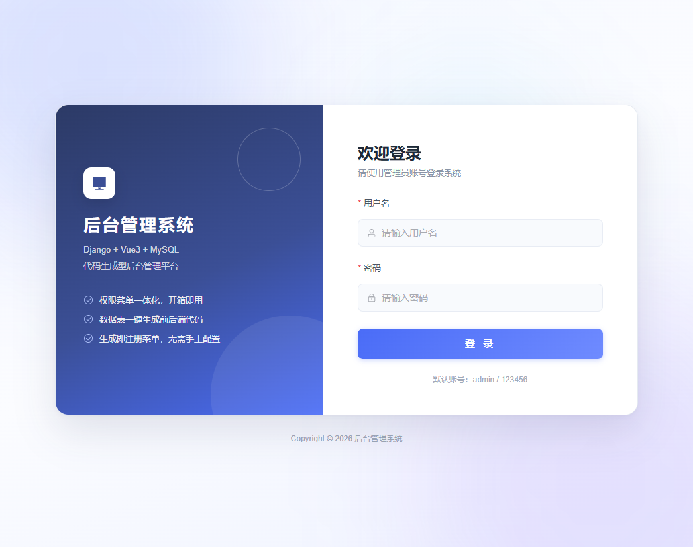
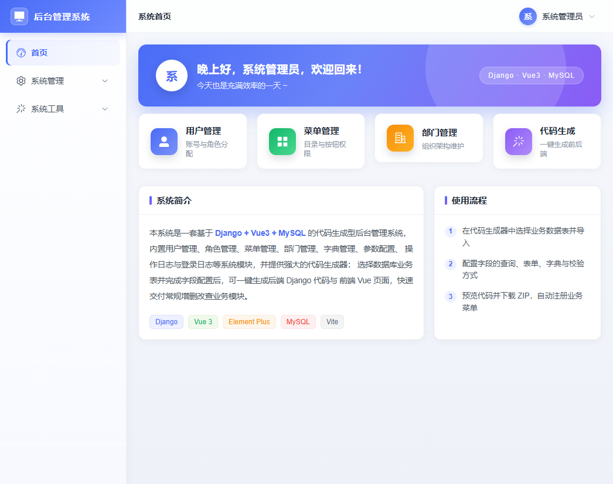
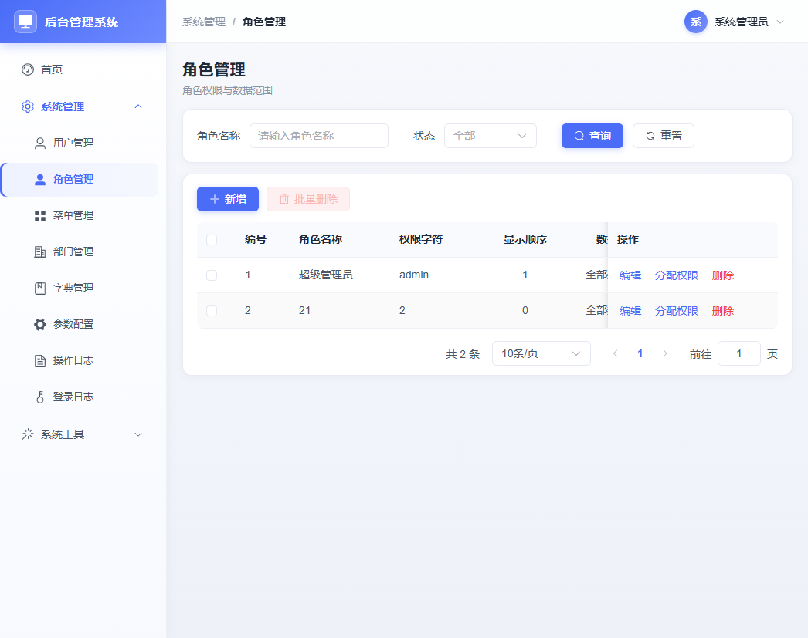
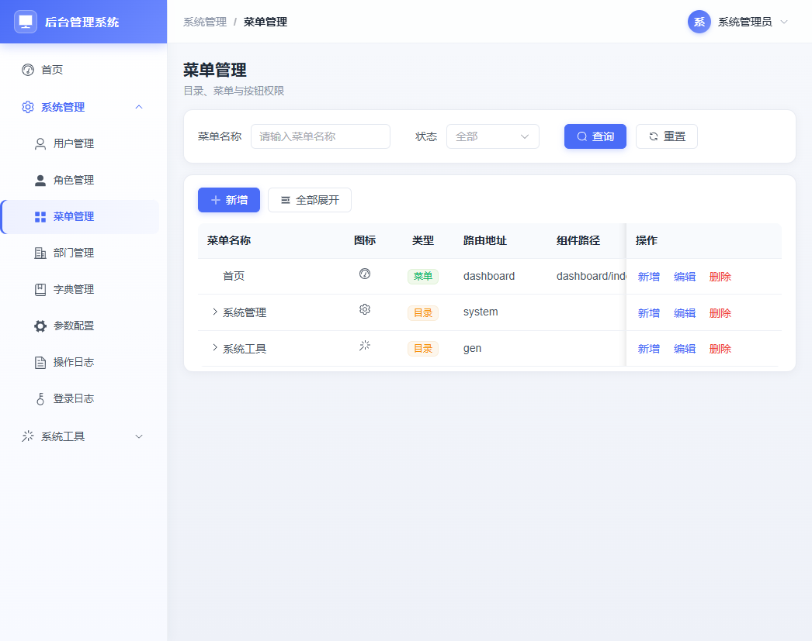
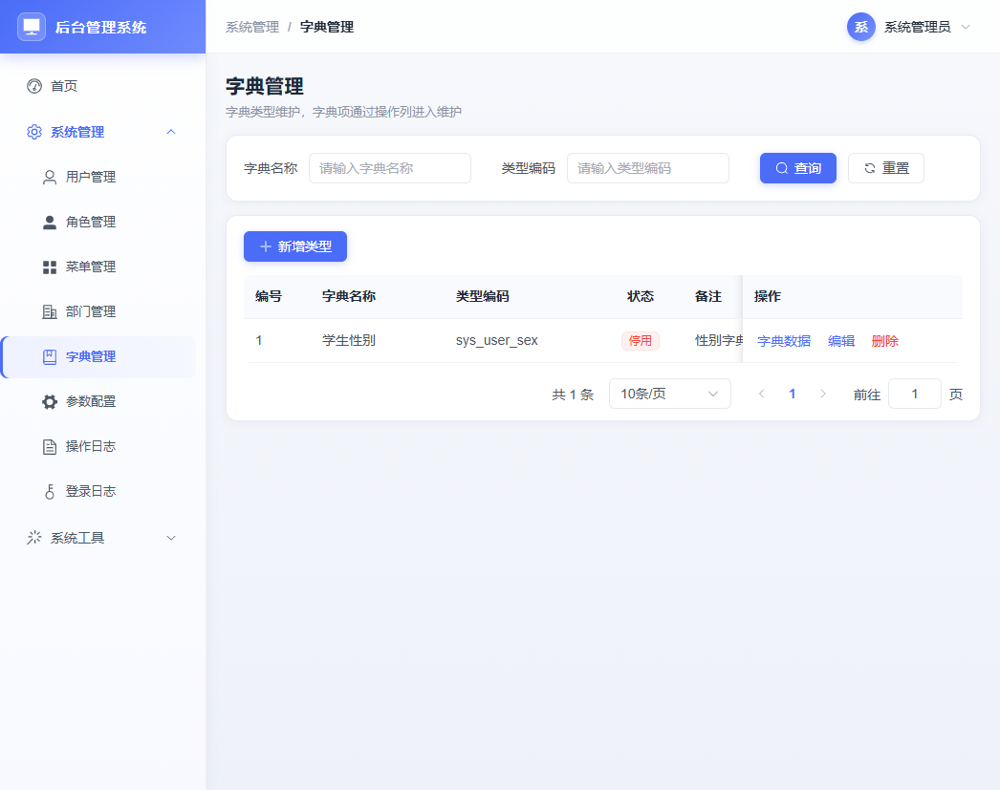
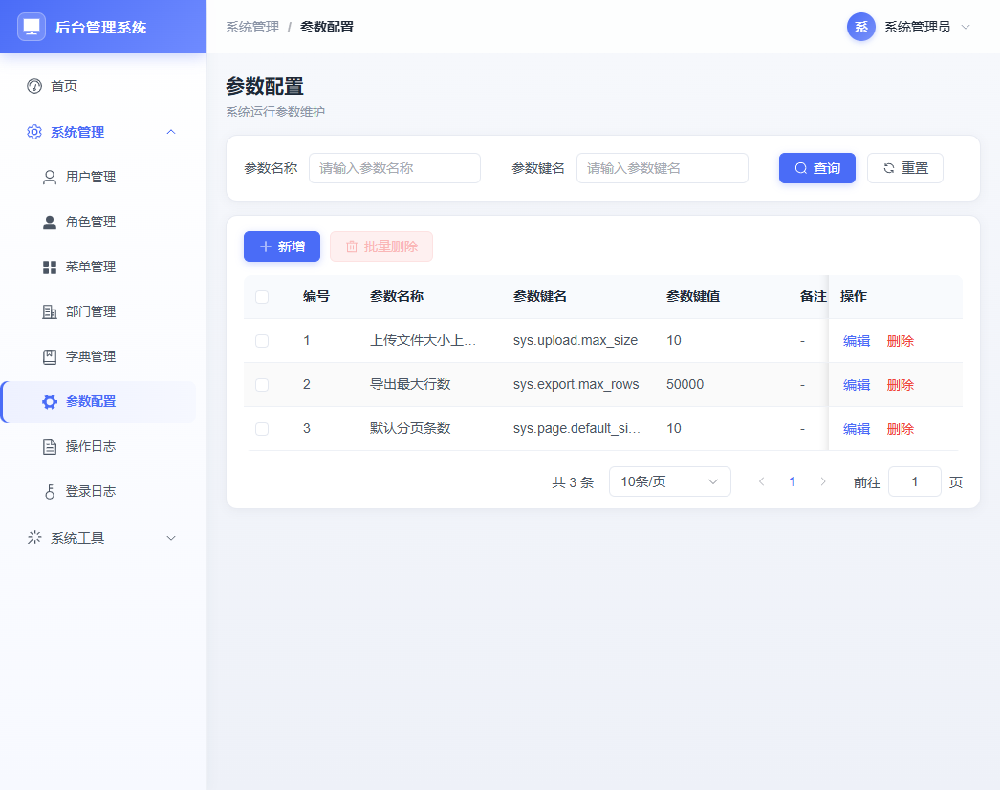
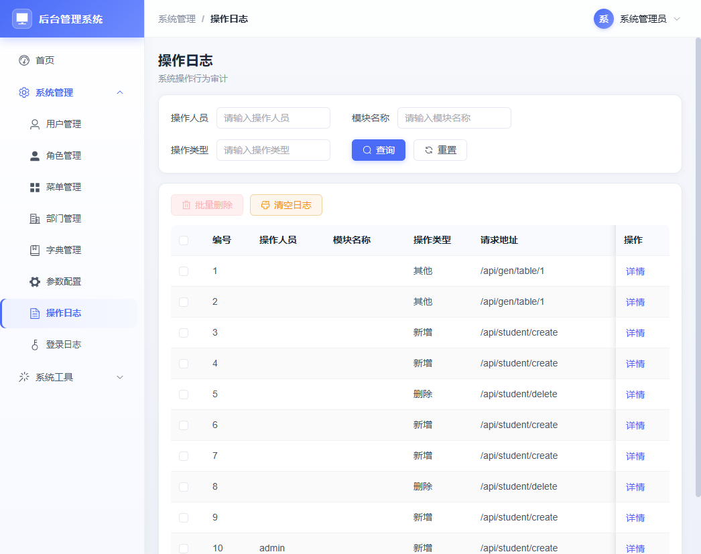
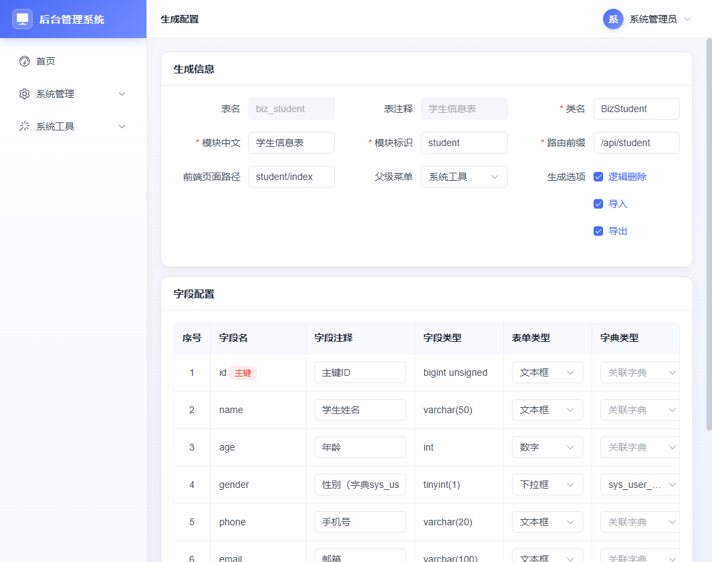
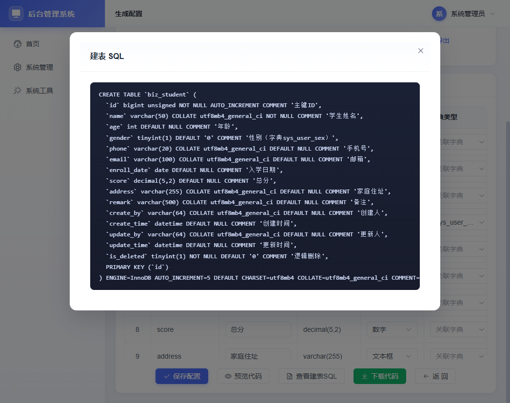
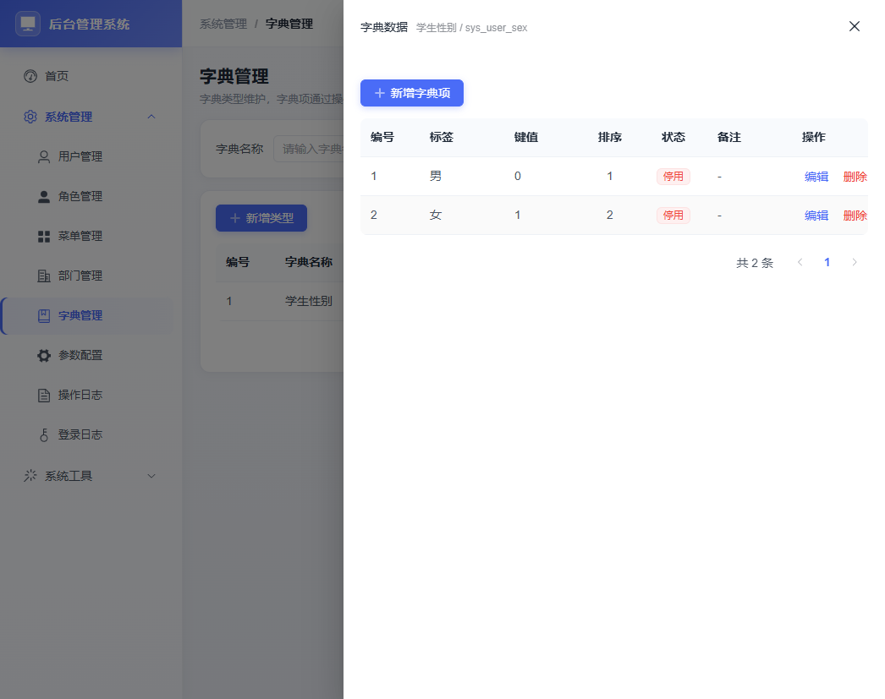

# 代码生成型后台管理系统

**简体中文** | [English](#english)

[](https://www.python.org/)
[](https://www.djangoproject.com/)
[](https://vuejs.org/)
[](https://element-plus.org/)
[](https://www.mysql.com/)

一个基于 **Django 4.2 + DRF + MySQL 8 + Vue 3 + Element Plus** 的后台管理系统。
内置完整的平台基础模块（用户、角色、菜单、部门、字典、参数、日志）、**代码生成器**（读表 → 配置 → 预览/下载 → 自动注册菜单）与**工作流审批模块**（BPMN 2.0 流程设计、流程发起、待办审批、抄送与流程轨迹）。

---

## 功能截图

| 登录页 | 首页仪表盘 |
|---|---|
|  |  |

| 用户管理 | 角色管理 |
|---|---|
|  |  |

| 菜单管理 | 部门管理 |
|---|---|
|  |  |

| 字典管理 | 参数配置 |
|---|---|
|  |  |

| 操作日志 | 登录日志 |
|---|---|
|  |  |

| 代码生成 - 表列表 | 代码生成 - 字段配置 |
|---|---|
|  |  |

| 代码生成 - 建表 SQL | 字典数据维护 |
|---|---|
|  |  |

| 生成模块示例（学生信息表） |
|---|
|  |

**附加模块页面预览**

| 附件管理 - 附件列表 | 附件管理 - 预览与编辑 |
|---|---|
| （附件列表网格，支持拖拽上传、MD5 秒传、业务类型筛选） | （kkFileView 只读预览 / OnlyOffice 协同编辑，水印可见） |

| 消息中心 - 站内消息 | 公告通知 - 公告列表 |
|---|---|
| （消息列表，未读红点、全部已读、跳转链接） | （公告列表，置顶标记、分类筛选、有效期倒计时） |

| 定时任务 - 任务列表 | 定时任务 - 运行日志 |
|---|---|
| （CRON /间隔调度、启停开关、立即执行按钮） | （任务日志时间轴，运行中/成功/失败三色标记） |

| 报表管理 - 报表设计 | 报表大屏 - 大屏设计 |
|---|---|
| （lowcode-report 拖拽画布，单元格合并、表达式、分组小计） | （datart 大屏画布，折线/柱状/饼图/地图组件，分享链接生成） |

| 外部对接 - 接口配置 | 外部对接 - 请求日志 |
|---|---|
| （接口配置表单，GET/POST/PUT/DELETE + Token/Basic 鉴权 + 连通性测试） | （请求日志列表，入参/返回/耗时/状态码/异常完整展示） |

---

## 功能特性

- **认证与权限**：自研 JWT（Token 2 小时，剩余 30 分钟静默续期）、bcrypt 密码、按钮级权限 `v-perm`、后端 `PermissionCheck` 校验、`admin` 通配权限。
- **动态菜单与路由**：登录后由后端下发菜单树，前端动态注册路由；菜单类型支持目录（M）/页面（C）/按钮（F）。
- **平台基础模块**：用户管理（角色分配、重置密码、状态开关）、角色管理（分配菜单）、菜单管理、部门树、字典管理（类型 + 数据）、参数配置、操作日志、登录日志。
- **代码生成器**：读取 `information_schema` → 导入业务表 → 字段级配置（表单类型、查询方式、字典、列表/查询/必填/导入/导出）→ 预览 9 个产物 → DDL 查看 → ZIP 下载 → 自动注册菜单与按钮权限。
- **生成模块能力**：标准 CRUD、条件查询、分页、批量删除、Excel 模板下载、批量导入（错误行提示）、条件导出。
- **工作流审批**：`工作流程` 三级菜单（流程管理 / 审批中心 / OA 示例）。bpmn-js 可视化设计 BPMN 2.0 流程，节点可配置指定用户 / 角色 / 部门 / 用户分组 / 表达式审批人，支持串行、或签、会签、排他/并行网关、抄送、超时到期时间与监听器；流程发布按版本隔离，运行中实例锁定发起时版本；审批中心提供发起流程、我的流程（可撤回）、待办（同意/驳回/转审/加签/退回）、已办、抄送我的；内置 OA 请假示例（请假超过 3 天自动加签总监审批）。
- **附件管理**：本地/MinIO 双存储切换、MD5 秒传去重、分片上传与断点续传、kkFileView 只读预览（PDF/Office/图片/视频）、OnlyOffice 在线协同编辑、业务类型绑定、预览水印、有效期自动清理、回收站恢复/彻底删除、全操作日志。
- **消息中心**：模板管理（站内信/短信/邮件/Webhook 四渠道，变量占位符）、站内消息已读/未读、全部已读/删除、推送日志与失败重试、渠道开关、前端 WebSocket 实时红点提醒。
- **公告通知**：公告分类、多渠道发布、角色范围控制、置顶、有效期（自动下线）、已读追踪、附件绑定、发布后自动推送消息中心。
- **定时任务**：CRON 与固定间隔两种调度、手动立即执行一次、运行日志（状态/返回/异常/耗时）、失败自动重试、Celery 异步执行 + 内置过期附件清理 / BPMN 超时检测 / 报表定时生成 / 消息重试四模板。
- **报表管理**：低代码报表模板拖拽设计（lowcode-report）、MySQL 本地 + API 外部双数据源、模板版本与角色权限、手动/定时生成 Excel/PDF、自动存入附件管理、生成记录与在线预览下载、WebSocket 实时查询。
- **报表大屏**：大屏拖拽设计（datart）、折线/柱状/饼图/数字指标/表格/地图组件、MySQL/API 数据集、发布后生成分享链接+访问密码、自动刷新秒、快照归档至附件管理、访问日志。
- **外部对接**：外部 API 配置（GET/POST/PUT/DELETE、Header/Query/Token/Basic 鉴权）、连通性一键测试、完整请求日志（入参/返回/耗时/状态码/异常）、手动/定时同步任务拉取外部数据写入本地库，报表与大屏模块直接选用已配置接口作为数据源。
- **工程规范**：统一响应 `{code, msg, data}`（HTTP 状态恒 200）、统一分页、全局异常处理、逻辑删除 `is_deleted`、操作日志中间件、`managed=False` 的 SQL-first 表结构、Element Plus 主题定制。
- **中英文文档**：本 README 提供中英文切换，`docs/` 下提供结构图、功能说明、运行部署与零基础学习路线。

## 技术栈

| 层 | 技术 | 说明 |
|---|---|---|
| 后端 | Django 4.2 + Django REST Framework | `ViewSet` + 自定义路由，统一响应与全局异常 |
| 认证 | 自研 JWT + bcrypt | `Authorization: Bearer`，`X-Refresh-Token` 静默续期 |
| 数据库 | MySQL 8 | 表由 SQL 脚本创建，模型 `managed=False` |
| 前端 | Vue 3（Composition API）+ Vite 5 | 无 Pinia，使用 `reactive` 轻量状态 |
| UI | Element Plus 2.x | 全局 CSS 变量主题覆盖 |
| 工作流 | 自研 Python BPMN 引擎 + bpmn-js | 解析 BPMN XML、Token 流转、网关与审批人策略；前端 Modeler 设计 / Viewer 轨迹高亮 |
| 定时任务 | Celery + Redis Broker | CRON / 间隔调度、失败重试、手动触发，内置 4 个系统模板 |
| 消息推送 | Django Channels + Redis WebSocket | 站内消息实时推送、未读红点提醒；预留短信/邮件/Webhook 渠道 |
| 附件预览 | kkFileView + OnlyOffice | kkFileView 只读在线预览（PDF/Office/图片/视频）；OnlyOffice 在线协同编辑 |
| 低代码报表 | lowcode-report 前端引擎 | 拖拽设计中国式报表、分组/交叉/参数报表，后端 MySQL/API 双数据源 |
| BI 大屏 | datart | 可视化大屏画布，折线/柱状/饼图/数字指标/地图组件，分享链接+密码访问 |
| 对象存储（可选） | MinIO SDK | 默认本地磁盘，切换 `wf_file_config` 的 `file.storage.type=minio` 即可启用 |
| 路由/请求 | vue-router 4 + axios | 动态路由、请求/响应拦截器 |

## 目录结构

```
django-base-admin/
├─ backend/                 # Django 后端
│  ├─ manage.py             # 管理入口（runserver / init_db / check）
│  ├─ config/               # settings、全局路由、wsgi/asgi
│  ├─ common/               # JWT、权限、分页、响应、异常、中间件、通用 CRUD
│  ├─ apps/
│  │  ├─ system/            # 用户/角色/菜单/部门/字典/配置/日志/认证
│  │  ├─ gen/               # 代码生成器（引擎 + 模板）
│  │  ├─ student/           # 生成模块示例（学生信息表）
│  │  ├─ workflow/          # 工作流：模型/实例/任务/引擎/监听器/菜单种子数据
│  │  ├─ file/              # 附件管理：上传/预览/配置/回收站
│  │  ├─ msg/               # 消息中心：模板/站内信/推送日志/渠道配置
│  │  ├─ notice/            # 公告通知：分类/公告/已读追踪
│  │  ├─ task_sched/        # 定时任务：任务信息/任务日志（Celery）
│  │  ├─ report/            # 报表管理：分类/数据源/模板/生成记录
│  │  ├─ bi/                # 报表大屏：大屏/数据集/访问日志
│  │  └─ outer/             # 外部对接：接口配置/请求日志/同步任务
│  └─ core/management/commands/init_db.py   # 建库建表与初始化数据
├─ frontend/                # Vue3 前端
│  └─ src/
│     ├─ router/            # 静态路由 + 动态路由（支持三级菜单）
│     ├─ store/auth.js      # 登录态、权限、菜单
│     ├─ utils/request.js   # axios 封装
│     ├─ layout/            # 侧边栏（三级菜单缩进）、导航栏、布局
│     ├─ components/workflow/  # 表单渲染、流程查看器、流程详情抽屉
│     └─ views/             # 登录、首页、system/*、gen/*、student、workflow/*
│        ├─ file/*          # 附件管理页面
│        ├─ msg/*           # 消息中心页面
│        ├─ notice/*        # 公告通知页面
│        ├─ task/*          # 定时任务页面
│        ├─ rp/*            # 报表管理页面
│        ├─ bi/*            # 报表大屏页面
│        └─ outer/*         # 外部对接页面
└─ docs/                    # 需求、建表 SQL 与 01~05 总结文档、截图
```

## 快速开始

> 详细步骤见 [docs/03-运行启动指南.md](docs/03-运行启动指南.md)。

**1. 准备数据库**

```sql
CREATE DATABASE gen_admin DEFAULT CHARACTER SET utf8mb4 COLLATE utf8mb4_unicode_ci;
```

执行 `docs/后台管理系统-初始化建表SQL.sql` 创建系统表；修改 `backend/config/settings.py` 中的 `DATABASES` 连接信息。

**2. 启动后端**

```bash
cd backend
python -m venv venv
# Windows: .\venv\Scripts\activate    macOS/Linux: source venv/bin/activate
pip install -r requirements.txt
python manage.py init_db        # 初始化菜单/按钮权限/管理员密码（注意 SQL_FILE 路径）
python manage.py runserver 0.0.0.0:8000
```

**3. 启动前端**

```bash
cd frontend
npm install
npm run dev                     # http://localhost:5173，/api 自动代理到 8000
```

**4. 登录**

| 账号 | 密码 | 说明 |
|---|---|---|
| `admin` | `123456` | 超级管理员，拥有全部权限 |

**5. 附加模块初始化（首次部署必填）**

附加模块的 22 张扩展表与默认数据需要单独执行一次：

```bash
# 方式 A：直接导入 SQL
mysql -u root -p gen_admin < docs/additional_module_init.sql

# 方式 B：init_db 已集成自动执行（推荐）
cd backend
python manage.py init_db
```

执行后登录，侧边栏将自动出现 **附件管理、消息中心、公告通知、定时任务、报表管理、报表大屏、外部对接** 7 个顶级菜单。

> 附加模块详情见 [docs/03-附加模块清单.md](docs/03-附加模块清单.md) 与 [docs/django-base-admin附加模块需求说明书.md](docs/django-base-admin附加模块需求说明书.md)。

## 文档索引

| 编号 | 文档 | 内容 |
|---|---|---|
| 00 | [文档导航](docs/00-文档导航.md) | 全部文档索引与推荐阅读路径 |
| 01 | [项目结构与调用关系](docs/01-项目结构与调用关系.md) | 架构图、时序图、**文件级调用矩阵**、数据库关系 |
| 02 | [功能说明文档](docs/02-功能说明文档.md) | 全部功能、接口清单、权限与业务规则 |
| 03 | [运行启动指南](docs/03-运行启动指南.md) | 环境、建库、初始化、启动、验证、FAQ |
| 04 | [多平台部署指南](docs/04-多平台部署指南.md) | Linux / Windows / Docker / 云平台部署 |
| 05 | [Java 开发者零基础学习路线](docs/05-Java开发者零基础学习路线.md) | Python/Django 与 Java/Spring 对照、分阶段读码与练习 |
| — | [工作流审批模块需求文档](docs/django-base-admin工作流审批模块需求文档.md) | BPMN 流程、11 张 `wf_` 表、审批中心与 OA 请假示例需求 |
| — | [工作流建表 SQL](docs/后台管理系统-工作流建表SQL.sql) | `wf_` 表建表语句（由 `init_db` 自动执行） |
| — | [附加模块需求说明书](docs/django-base-admin附加模块需求说明书.md) | 附件/消息/公告/定时任务/报表/大屏/外部对接 7 模块完整需求 |
| — | [附加模块建表 SQL](docs/additional_module_init.sql) | 附加模块 22 张扩展表建表语句 |
| — | [附加模块清单](docs/03-附加模块清单.md) | 22 张表字段、菜单树、前端页面、API 端点速查 |

## 工作流审批使用流程

1. 进入 **工作流程 → 流程管理**，先维护流程分类、自定义表单、用户分组、监听器与表达式；
2. 新建流程模型并点击「设计」，在 bpmn-js 画布拖拽 BPMN 2.0 图，选中审批节点配置审批人、审批方式与超时时间；
3. 点击「发布」生成新版本；已运行实例继续使用发起时版本，互不影响；
4. 普通用户在 **审批中心 → 发起流程** 选择已发布模型，填写表单并提交；
5. 审批人在 **待办任务** 中同意 / 驳回 / 转审 / 加签 / 退回，可在详情抽屉查看审批轨迹、表单与流程图；
6. 抄送人在 **抄送我的** 查看只读流程并自动标记已读；**OA 示例 → 请假查询** 演示业务表单与流程联动。

## 代码生成器使用流程

1. 在 MySQL 中创建业务表；
2. 进入 **系统工具 → 代码生成**，点击「导入数据表」；
3. 在字段配置页调整表单类型、查询方式、字典、列表/查询/导入/导出等；
4. 「预览」查看 9 个生成文件，「DDL」查看建表语句；
5. 「下载」得到 ZIP，按包内 `README-部署说明.txt` 复制到 `backend/apps/` 与 `frontend/src/`；
6. 注册 `INSTALLED_APPS`、`config/urls.py`，重启后端并刷新菜单；
7. 新菜单出现，即可使用 CRUD、导入、导出与操作日志。

## 部署

支持 Linux（Nginx + Gunicorn + systemd）、Windows Server（Waitress + Nginx/IIS）、Docker / docker-compose，以及阿里云/腾讯云等云平台与对象存储/CDN 前端托管。完整配置与命令见 [docs/04-多平台部署指南.md](docs/04-多平台部署指南.md)。

## 许可

本项目仅用于学习与内部项目参考，未附带开源许可证文件；如需开源发布请自行补充 LICENSE。

---

<h1 id="english">English</h1>

[简体中文](#代码生成型后台管理系统) | **English**

# Code-Generating Admin System

An admin system built with **Django 4.2 + DRF + MySQL 8 + Vue 3 + Element Plus**. It ships with a complete platform foundation (users, roles, menus, departments, dictionaries, configs, logs), a **code generator** (read tables → configure → preview/download → auto-register menus), and a **workflow approval module** (BPMN 2.0 modeling, process start, to-do approvals, CC and process traces).

## Screenshots

| Login | Dashboard |
|---|---|
|  |  |

| User Management | Role Management |
|---|---|
|  |  |

| Menu Management | Department Management |
|---|---|
|  |  |

| Dictionary Management | System Config |
|---|---|
|  |  |

| Operation Log | Login Log |
|---|---|
|  |  |

| Code Generator - Tables | Code Generator - Field Config |
|---|---|
|  |  |

| Code Generator - DDL | Dictionary Data |
|---|---|
|  |  |

| Generated Module (Students) |
|---|
|  |

**Additional Module Previews**

| File - Attachment List | File - Preview & Edit |
|---|---|
| (attachment grid, drag-drop upload, MD5 dedup, business-type filter) | (kkFileView read-only / OnlyOffice collaborative edit, watermark visible) |

| Messages - In-site List | Announcements - List |
|---|---|
| (message list, unread red dot, mark-all-read, jump links) | (announcement list, top-pin badge, category filter, effective-time countdown) |

| Scheduler - Tasks | Scheduler - Execution Log |
|---|---|
| (Cron / interval scheduling, on/off switch, run-now button) | (log timeline, 3 colors: running / success / failure) |

| Report - Template Designer | BI - Dashboard Designer |
|---|---|
| (lowcode-report drag canvas, cell merge, expressions, group totals) | (datart canvas with line/bar/pie/map components, share-link generator) |

| External - API Config | External - Request Log |
|---|---|
| (config form, GET/POST/PUT/DELETE + Token/Basic auth + connectivity test) | (request log with params/response/duration/status/error) |

## Features

- **Auth & permissions**: custom JWT (2-hour token, silent refresh when 30 minutes remain), bcrypt passwords, button-level `v-perm` directive, backend `PermissionCheck`, wildcard permission for `admin`.
- **Dynamic menus & routes**: menus are delivered by the backend after login and registered as Vue routes at runtime (directory / page / button types).
- **Platform modules**: users (role assignment, password reset, status toggle), roles (menu assignment), menus, department tree, dictionaries (types + data), system configs, operation logs, login logs.
- **Code generator**: inspect `information_schema` → import business tables → per-field configuration (form widget, query type, dictionary, list/query/required/import/export) → preview 9 artifacts → view DDL → download ZIP → auto-register menus and button permissions.
- **Generated module capabilities**: standard CRUD, conditional search, pagination, batch delete, Excel template download, batch import with row-level error messages, conditional export.
- **Workflow approvals**: a three-level `Workflow` menu (Process Management / Approval Center / OA Samples). Design BPMN 2.0 diagrams with bpmn-js; assign approvers by user, role, department, user group or expression; support serial, any-one and all-sign modes, exclusive/parallel gateways, CC, due-time and listeners. Publishing creates a new version while running instances stay on their start-time version. The Approval Center covers start, my processes (withdraw), to-do (approve/reject/transfer/add-sign/return), done and CC lists; a leave-request OA sample routes requests over 3 days to a director.
- **File & attachment management**: local disk / MinIO dual storage, MD5 instant-upload dedup, chunked upload with resume, kkFileView read-only preview (PDF/Office/images/video), OnlyOffice collaborative editing, business-type binding, preview watermark, expiry auto-clean, recycle bin with restore/permanent delete, full operation audit log.
- **Message center**: template management (4 channels: in-site/SMS/email/Webhook with variable placeholders), read/unread in-site messages, mark-all-read, push log with retry per channel, WebSocket real-time red-dot in header.
- **Announcements**: categories, multi-channel publish, role-based visibility scope, top-pin, effective time window (auto-offline), read tracking, attachment binding, auto-push to message center on publish.
- **Scheduled tasks**: Celery with Cron expression and fixed-interval modes, manual one-shot trigger, execution log (status/return/error/duration), auto-retry on failure, 4 built-in templates (expired file cleanup / BPMN timeout detection / report scheduled generation / message retry).
- **Report management**: low-code drag-and-drop designer (lowcode-report), MySQL + API dual data sources, template versioning and role permission, manual / scheduled Excel & PDF generation, auto-save to attachment module, generation records with kkFileView preview, WebSocket real-time queries.
- **BI dashboards**: drag-and-drop canvas (datart), line/bar/pie/number indicator/table/map components, MySQL/API datasets, shareable URL with access password, configurable auto-refresh seconds, snapshot archive, access log.
- **External integration**: external API config (GET/POST/PUT/DELETE, headers/query, Token/Basic auth), one-click connectivity test, full request log (params/response/duration/status/error), manual/scheduled sync tasks that pull external data into local tables; report and BI modules directly pick configured APIs as data sources.
- **Engineering conventions**: unified response `{code, msg, data}` (HTTP status always 200), unified pagination, global exception handler, logical delete `is_deleted`, operation-log middleware, SQL-first schema with `managed=False`, custom Element Plus theme.
- **Bilingual docs**: this README supports Chinese/English switching; the `docs/` folder contains architecture, feature, run/deploy and beginner guides.

## Tech Stack

| Layer | Technology | Notes |
|---|---|---|
| Backend | Django 4.2 + Django REST Framework | `ViewSet` + hand-written routes, unified response & exceptions |
| Auth | Custom JWT + bcrypt | `Authorization: Bearer`, `X-Refresh-Token` silent renewal |
| Database | MySQL 8 | Schema created by SQL script, models use `managed=False` |
| Frontend | Vue 3 (Composition API) + Vite 5 | No Pinia; a lightweight `reactive` store |
| UI | Element Plus 2.x | Global CSS variable theme overrides |
| Workflow | Custom Python BPMN engine + bpmn-js | Parses BPMN XML, token flow, gateways and approver strategies; Modeler for design, Viewer with active-node highlighting |
| Scheduler | Celery + Redis Broker | Cron / interval scheduling, auto-retry, one-shot manual trigger, 4 built-in system templates |
| WebSocket | Django Channels + Redis | Real-time in-site message push, unread red dots; SMS/email/Webhook channels reserved |
| File preview | kkFileView + OnlyOffice | kkFileView read-only online preview (PDF/Office/images/video); OnlyOffice collaborative editing |
| Low-code reports | lowcode-report frontend engine | Drag-to-design Chinese-style reports, group/cross/parameter reports, MySQL + API dual data sources |
| BI dashboards | datart | Visual dashboard canvas with line/bar/pie/number/map components, shareable URL with password |
| Object storage (optional) | MinIO SDK | Defaults to local disk; flip `wf_file_config.file.storage.type=minio` to switch |
| Routing / HTTP | vue-router 4 + axios | Dynamic routes, request/response interceptors |

## Quick Start

> Full steps: [docs/03-运行启动指南.md](docs/03-运行启动指南.md) (Chinese).

**1. Database**

```sql
CREATE DATABASE gen_admin DEFAULT CHARACTER SET utf8mb4 COLLATE utf8mb4_unicode_ci;
```

Run `docs/后台管理系统-初始化建表SQL.sql`, then update `DATABASES` in `backend/config/settings.py`.

**2. Backend**

```bash
cd backend
python -m venv venv
# Windows: .\venv\Scripts\activate    macOS/Linux: source venv/bin/activate
pip install -r requirements.txt
python manage.py init_db
python manage.py runserver 0.0.0.0:8000
```

**3. Frontend**

```bash
cd frontend
npm install
npm run dev            # http://localhost:5173, proxies /api to port 8000
```

**4. Login**: `admin / 123456`

**5. Additional module initialization (first deploy required)**

The 22 extended tables and seed data for the 7 new modules must be loaded once:

```bash
# Option A — import SQL directly
mysql -u root -p gen_admin < docs/additional_module_init.sql

# Option B — init_db already bundles it (recommended)
cd backend
python manage.py init_db
```

After login, seven top-level menus will appear automatically: **File & Attachments, Message Center, Announcements, Scheduled Tasks, Report Management, BI Dashboards, External Integration**.

> Details: [docs/03-附加模块清单.md](docs/03-附加模块清单.md) and [docs/django-base-admin附加模块需求说明书.md](docs/django-base-admin附加模块需求说明书.md).

## Documentation

| No. | Document | Content |
|---|---|---|
| 00 | [Doc index](docs/00-文档导航.md) | Index and recommended reading paths |
| 01 | [Architecture & call graph](docs/01-项目结构与调用关系.md) | Architecture diagrams, sequences, file-level call matrix, DB relations |
| 02 | [Feature specification](docs/02-功能说明文档.md) | All features, API list, permissions and rules |
| 03 | [Run guide](docs/03-运行启动指南.md) | Setup, initialization, startup, verification, FAQ |
| 04 | [Deployment guide](docs/04-多平台部署指南.md) | Linux / Windows / Docker / cloud deployment |
| 05 | [Learning path for Java developers](docs/05-Java开发者零基础学习路线.md) | Python/Django vs Java/Spring mapping, staged code-reading plan |
| — | [Workflow module requirements](docs/django-base-admin工作流审批模块需求文档.md) | BPMN process, 11 `wf_` tables, approval center and leave-request sample |
| — | [Workflow DDL](docs/后台管理系统-工作流建表SQL.sql) | `wf_` table definitions executed by `init_db` |
| — | [Additional module requirements](docs/django-base-admin附加模块需求说明书.md) | Full requirements for 7 new modules (file/msg/notice/scheduler/report/BI/integration) |
| — | [Additional module DDL](docs/additional_module_init.sql) | 22 extended table definitions and default seed data |
| — | [Additional module checklist](docs/03-附加模块清单.md) | Quick reference: 22 tables, menu tree, frontend pages, API endpoints |

## Workflow Approval Workflow

1. Go to **Workflow → Process Management** and maintain categories, custom forms, user groups, listeners and expressions.
2. Create a process model and click "Design" to drag a BPMN 2.0 diagram; select an approval node to configure approvers, approval mode and due time.
3. Click "Publish" to create a new version; running instances keep the version they started with.
4. Business users open **Approval Center → Start Process**, fill in the bound form and submit.
5. Approvers act in **To-do Tasks** (approve / reject / transfer / add-sign / return) and inspect traces, forms and diagrams in the detail drawer.
6. CC users read processes in **CC to Me** (auto-marked as read); **OA Samples → Leave Requests** demonstrates form/process integration.

## Code Generator Workflow

1. Create a business table in MySQL.
2. In **System Tools → Code Generator**, click "Import tables".
3. Adjust each field: widget type, query type, dictionary, list/search/required/import/export.
4. "Preview" the 9 generated files; "DDL" shows the table definition.
5. "Download" the ZIP and follow `README-部署说明.txt` to copy files into `backend/apps/` and `frontend/src/`.
6. Register the new app in `INSTALLED_APPS` and `config/urls.py`, restart the backend and refresh the menu.
7. The new menu appears with CRUD, import, export and operation logging ready.

## Deployment

Linux (Nginx + Gunicorn + systemd), Windows Server (Waitress + Nginx/IIS), Docker / docker-compose, and cloud platforms with object storage/CDN for the frontend. See [docs/04-多平台部署指南.md](docs/04-多平台部署指南.md) for complete configs and commands.

## License

This project is provided for learning and internal reference only. No license file is included; add your own LICENSE before open-sourcing.
