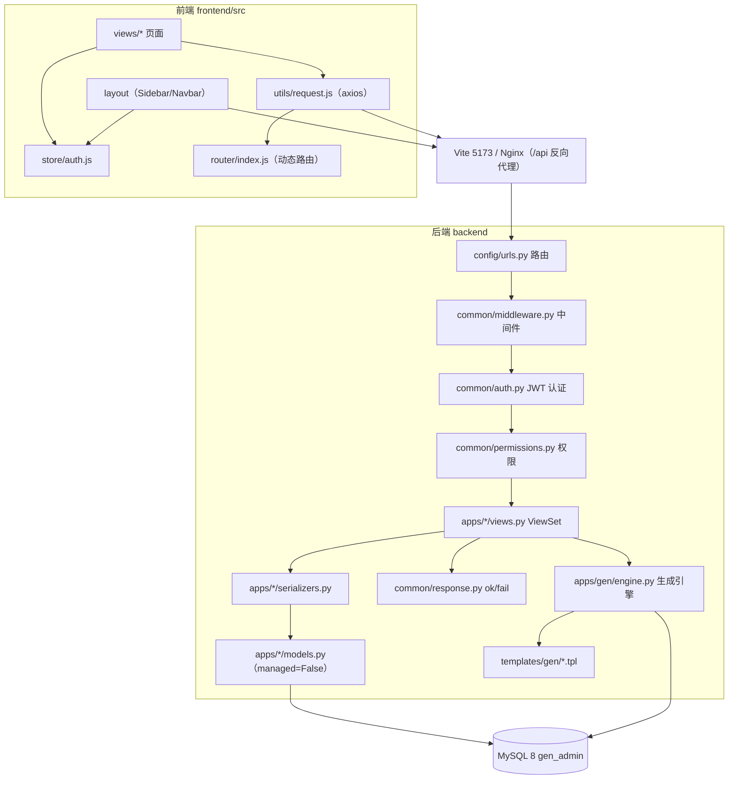
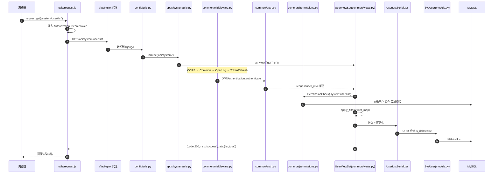
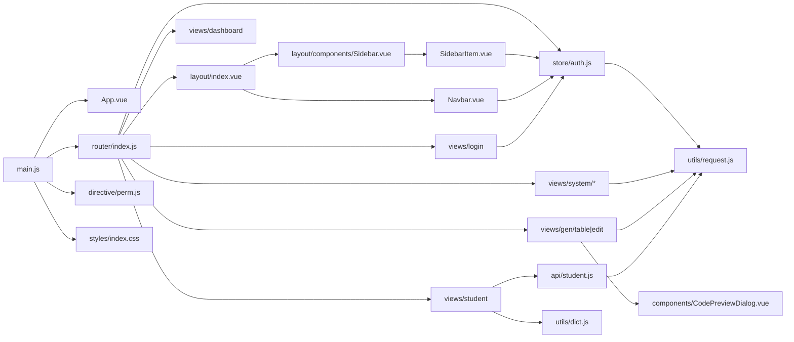
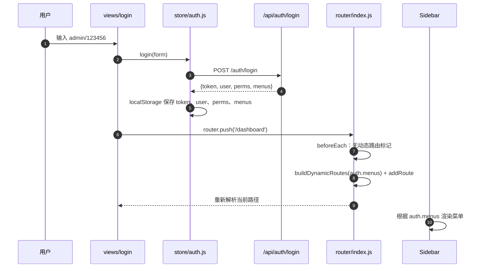
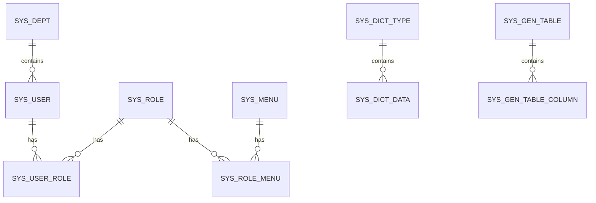

# 01 - 项目结构与调用关系

> 本文档回答三个问题：**项目由哪些文件组成、一次请求经过哪些文件、文件之间谁调用谁**。
> 配套文档：[00-文档导航](./00-文档导航.md) · [02-功能说明文档](./02-功能说明文档.md) · [03-运行启动指南](./03-运行启动指南.md) · [04-多平台部署指南](./04-多平台部署指南.md) · [05-Java开发者零基础学习路线](./05-Java开发者零基础学习路线.md)

---

## 1. 项目概览

| 项 | 内容 |
|---|---|
| 后端 | Django 4.2 + Django REST Framework（DRF） |
| 数据库 | MySQL 8，库名 `gen_admin`；模型 `managed=False`，表用 SQL 脚本创建 |
| 认证 | 自研 JWT（HS256，2 小时），`Authorization: Bearer`，`X-Refresh-Token` 静默续期 |
| 密码 | bcrypt |
| 前端 | Vue 3 + Vite 5 + Element Plus + vue-router 4 + axios；无 Pinia |
| 菜单/权限 | 菜单由后端下发，前端动态注册路由；按钮权限 `v-perm` + 后端 `PermissionCheck` |
| 响应约定 | HTTP 状态恒 200，业务码在响应体 `code`（400/401/403/500） |
| 特色 | 代码生成器：读表 → 配置 → 预览/DDL/下载 ZIP → 自动注册菜单 |

---

## 2. 目录树与文件职责

```
django-base-admin/
├─ README.md                        # 项目说明（中英文切换 + 功能截图）
├─ docs/                            # 需求、建表 SQL、01~05 文档与截图
├─ backend/
│  ├─ manage.py                     # Django 命令行入口（runserver / init_db / check）
│  ├─ requirements.txt              # Python 依赖
│  ├─ config/
│  │  ├─ settings.py                # 数据库/JWT/中间件/DRF/CORS/时区/日志
│  │  ├─ urls.py                    # 全局路由挂载：api/auth、api/system、api/gen、api/
│  │  ├─ wsgi.py / asgi.py          # 部署入口
│  │  └─ __init__.py
│  ├─ common/                       # 公共基础设施
│  │  ├─ auth.py                    # JWT 签发/解析 + JWTAuthentication + LoginRequired
│  │  ├─ permissions.py             # 权限标识查询与校验（PermissionCheck）
│  │  ├─ views.py                   # 通用 CRUD ViewSet 基类 CrudViewSet
│  │  ├─ pagination.py              # 统一分页 StandardPagination
│  │  ├─ response.py                # ok() / fail() 统一响应
│  │  ├─ exception.py               # DRF 全局异常处理
│  │  ├─ middleware.py              # 操作日志 + token 静默续期
│  │  └─ utils.py                   # bcrypt、树构建、时间、BaseModel 等
│  ├─ apps/
│  │  ├─ system/                    # 平台基础模块
│  │  │  ├─ models.py               # SysUser/SysRole/SysMenu/SysDept/字典/配置/日志
│  │  │  ├─ serializers.py          # 各模块序列化与校验
│  │  │  ├─ urls_auth.py            # /api/auth/* 路由
│  │  │  ├─ urls.py                 # /api/system/* 路由（crud() 生成器）
│  │  │  └─ views/
│  │  │     ├─ auth.py              # 登录/登出/用户信息/菜单权限
│  │  │     ├─ user.py              # 用户 CRUD、重置密码、状态、分配角色
│  │  │     ├─ role.py              # 角色 CRUD、菜单回显/分配
│  │  │     ├─ menu.py              # 菜单 CRUD、树
│  │  │     ├─ dept.py              # 部门 CRUD、树
│  │  │     ├─ dict.py              # 字典类型/字典数据、all 缓存接口
│  │  │     ├─ config.py            # 参数配置 CRUD
│  │  │     └─ logs.py              # 操作日志/登录日志、清空
│  │  ├─ gen/                       # 代码生成器
│  │  │  ├─ models.py               # SysGenTable / SysGenTableColumn
│  │  │  ├─ serializers.py          # 配置读写
│  │  │  ├─ urls.py                 # /api/gen/* 路由
│  │  │  ├─ views.py                # 表列表、导入、配置保存、预览、DDL、下载
│  │  │  ├─ engine.py               # 核心引擎：读表、推断、渲染、ZIP、注册菜单
│  │  │  └─ templates/gen/*.tpl     # models/serializers/views/urls/apps/readme 模板
│  │  └─ student/                   # 生成模块示例（学生信息表）
│  │     ├─ models.py / serializers.py / views.py / urls.py
│  ├─ core/
│  │  └─ management/commands/init_db.py   # 建库、执行 SQL、初始化菜单与 admin 密码
│  └─ venv/                         # 虚拟环境（不入库）
└─ frontend/
   ├─ package.json / vite.config.js # 依赖、脚本、/api 代理
   └─ src/
      ├─ main.js                    # 入口：Element Plus、图标、v-perm、样式
      ├─ App.vue
      ├─ router/index.js            # 静态路由 + 动态路由 + 路由守卫
      ├─ store/auth.js              # token/user/perms/menus 与登录登出
      ├─ utils/
      │  ├─ request.js              # axios：baseURL=/api、token、续期、统一错误
      │  ├─ dict.js                 # 字典缓存与 dictLabel
      │  ├─ download.js             # 文件下载
      │  └─ icon.js                 # 图标注册/映射
      ├─ directive/perm.js          # 按钮权限指令
      ├─ api/student.js             # 生成模块 API 封装
      ├─ layout/index.vue           # 布局容器
      ├─ layout/components/         # Sidebar / SidebarItem / Navbar
      ├─ styles/index.css           # 全局主题（Element Plus CSS 变量覆盖）
      ├─ components/CodePreviewDialog.vue  # 代码预览弹窗
      └─ views/
         ├─ login/index.vue         # 登录页
         ├─ dashboard/index.vue     # 首页
         ├─ system/{user,role,menu,dept,dict,config,operlog,loginlog}/index.vue
         ├─ gen/table/index.vue     # 代码生成：表列表/导入
         ├─ gen/edit/index.vue      # 代码生成：字段配置/预览/下载
         ├─ student/index.vue       # 生成模块页面
         └─ error/404.vue
```

---

## 3. 分层架构



---

## 4. 一次 API 请求的完整调用链

以 `GET /api/system/user/list?page=1&page_size=10` 为例：



---

## 5. 前端文件调用关系



> 说明：除生成模块外，系统页面直接使用 `utils/request`（项目有意不抽 `api/*.js` 层，减少样板代码）。生成器产出的模块则附带 `api/{module}.js`。

---

## 6. 登录与动态路由时序



关键点：

- 菜单树来自 `/api/auth/userinfo`（登录响应也带一份），`menu_type` M=目录、C=页面、F=按钮。
- 动态路由的 `component` 字符串（如 `system/user/index`）在 `router/index.js` 中映射为 `../views/${component}.vue`。
- 刷新深层链接时，路由守卫用 `path` 重新解析（不能用 `{...to}`，否则会保留 404 的 `name`）。

---

## 7. 代码生成器全链路

```mermaid
flowchart TD
    A["views/gen/table/index.vue"] -->|GET /api/gen/db/tables| B["engine.list_db_tables"]
    B --> C[("information_schema.tables")]
    A -->|POST /api/gen/db/import| D["engine.import_table"]
    D --> E[("sys_gen_table / sys_gen_table_column")]
    F["views/gen/edit/index.vue"] -->|PUT /api/gen/table/{id}| G["views.GenTableViewSet.update"]
    G --> E
    F -->|GET .../preview| H["engine.render_files"]
    H --> I["templates/gen/*.tpl + build_vue_page/build_api_js"]
    F -->|GET .../ddl| J["engine.get_table_ddl（SHOW CREATE TABLE）"]
    F -->|GET .../download| K["ZIP：9 个产物 + create_menus"]
    K --> L[("sys_menu / sys_role_menu")]
    K --> M["前端刷新菜单 → 动态路由出现新页面"]
```

生成的 9 个产物：

```
backend/apps/{module_name}/{__init__,apps,models,serializers,views,urls}.py
README-部署说明.txt
frontend/src/api/{module_name}.js
frontend/src/views/{gen_path}.vue
```

---

## 8. 文件级调用关系矩阵

### 8.1 后端

| 文件 | 核心职责 | 被谁调用/依赖 | 调用/依赖谁 |
|---|---|---|---|
| `manage.py` | 命令行入口 | 开发者/运维 | `config.settings`、`django` 命令框架 |
| `config/settings.py` | 全局配置 | `manage.py`、`wsgi/asgi`、所有 app | 无（被依赖） |
| `config/urls.py` | 全局路由 | Django | `apps.system.urls_auth`、`apps.system.urls`、`apps.gen.urls`、`apps.student.urls` |
| `common/response.py` | `ok/fail` 统一响应 | 所有 views、exception | DRF `Response` |
| `common/utils.py` | bcrypt、时间、树、BaseModel | auth、serializers、views、init_db | `bcrypt`、`datetime` |
| `common/pagination.py` | 分页 | `common/views.py` | DRF `PageNumberPagination` |
| `common/auth.py` | JWT 认证、`LoginRequired` | `common/middleware.py`、views | `settings.JWT_CONFIG`、`apps.system.models`、`jwt` |
| `common/permissions.py` | 权限标识校验 | `CrudViewSet`、gen 视图 | `apps.system.models`、原生 SQL |
| `common/views.py` | 通用 CRUD 基类 | system 各 ViewSet、student | `pagination`、`permissions`、`response` |
| `common/exception.py` | 全局异常 | DRF 配置 | `response.fail`、`logging` |
| `common/middleware.py` | 操作日志、token 续期 | `settings.MIDDLEWARE` | `common.auth.create_token`、`apps.system.models` |
| `apps/system/models.py` | 系统表模型 | serializers、views、common | Django ORM |
| `apps/system/serializers.py` | 校验与序列化 | views | models、`common.utils.hash_password` |
| `apps/system/urls_auth.py` | `/api/auth/*` | `config.urls` | `views/auth.py` |
| `apps/system/views/auth.py` | 登录/登出/userinfo | `urls_auth` | models、`common.auth`、`common.utils` |
| `apps/system/urls.py` | `/api/system/*` + `crud()` | `config.urls` | 各 system views |
| `apps/system/views/user.py` | 用户 CRUD/状态/角色 | urls | models、serializers、`hash_password` |
| `apps/system/views/role.py` | 角色/菜单授权 | urls | models、原生 SQL |
| `apps/system/views/menu.py` | 菜单树/CRUD | urls | models、`build_tree` |
| `apps/system/views/dept.py` | 部门树/CRUD | urls | models、`build_tree` |
| `apps/system/views/dict.py` | 字典类型/数据 | urls | models |
| `apps/system/views/config.py` | 参数配置 | urls | models |
| `apps/system/views/logs.py` | 操作/登录日志 | urls | models |
| `apps/gen/models.py` | 生成配置表 | gen views/engine | Django ORM |
| `apps/gen/urls.py` | `/api/gen/*` | `config.urls` | `views.GenTableViewSet` |
| `apps/gen/views.py` | 表列表/导入/保存/预览/下载 | urls | `engine`、models、serializers、`SysMenu`、`transaction` |
| `apps/gen/engine.py` | 读表、推断、渲染、ZIP、注册菜单 | gen views | `connection`、Django Template、`templates/gen/*.tpl`、gen models |
| `apps/student/urls.py` | `/api/student/*` | `config.urls` | `views.py` |
| `apps/student/views.py` | 示例模块 CRUD/导入/导出 | urls | models、serializers、`openpyxl`、`SysConfig` |
| `core/management/commands/init_db.py` | 建库/建表/初始化 | 开发者 | `pymysql`、`settings`、`hash_password`、`docs/*.sql` |

### 8.2 前端

| 文件 | 核心职责 | 被谁调用 | 调用谁 |
|---|---|---|---|
| `main.js` | 应用入口 | `index.html` | `App.vue`、router、v-perm、样式、Element Plus |
| `router/index.js` | 路由与守卫 | `main.js` | views、`store/auth`、`layout`、`utils/dict` |
| `store/auth.js` | 登录态/权限/菜单 | 页面、布局、router | `utils/request`、`localStorage` |
| `utils/request.js` | axios 封装 | 所有页面/api | 后端 HTTP、`ElMessage` |
| `utils/dict.js` | 字典缓存 | 页面 | `/system/dict/data/all` |
| `directive/perm.js` | `v-perm` | `main.js` | `store/auth.hasPerm` |
| `layout/index.vue` | 布局 | router | Sidebar、Navbar |
| `Sidebar/SidebarItem` | 菜单渲染/缩进 | layout | `store/auth`、vue-router |
| `Navbar.vue` | 面包屑/退出 | layout | `store/auth`、router |
| `views/login` | 登录表单 | router | `store/auth.login` |
| `views/dashboard` | 首页概览 | router | 静态数据 |
| `views/system/*` | 系统模块页面 | router | `utils/request`、`utils/dict` |
| `views/gen/table` | 表列表/导入 | router | `utils/request` |
| `views/gen/edit` | 字段配置/预览/下载 | router | `utils/request`、`CodePreviewDialog` |
| `components/CodePreviewDialog.vue` | 代码预览弹窗 | gen 页面 | 无 |
| `views/student` | 生成模块页面 | router | `api/student.js`、`utils/dict` |
| `api/student.js` | 学生模块接口 | student 页面 | `utils/request` |

---

## 9. 数据库表关系



| 表 | 用途 |
|---|---|
| `sys_user` | 用户（含 `dept_id`、`status` 布尔、逻辑删除） |
| `sys_role` | 角色（`role_key`、`data_scope`、状态） |
| `sys_menu` | 菜单/按钮（`menu_type` M/C/F、`perms`、`component`、`parent_id`） |
| `sys_dept` | 部门树（`parent_id`、负责人） |
| `sys_user_role` | 用户-角色关联 |
| `sys_role_menu` | 角色-菜单关联 |
| `sys_dict_type` / `sys_dict_data` | 字典类型与字典项 |
| `sys_config` | 参数配置（如 `sys.export.max_rows`） |
| `sys_oper_log` | 操作日志（模块、类型、参数、结果、耗时） |
| `sys_login_log` | 登录日志（IP、UA、状态） |
| `sys_gen_table` / `sys_gen_table_column` | 代码生成配置 |
| `biz_student` | 生成模块示例业务表 |

---

## 10. 示例生成模块（student）调用关系

```
views/student/index.vue
  → api/student.js
    → utils/request.js（baseURL /api）
      → GET/POST/PUT/DELETE /api/student/*
        → config/urls.py → apps/student/urls.py
          → apps/student/views.py（StudentViewSet）
            → apps/student/serializers.py
              → apps/student/models.py（BizStudent）
                → MySQL biz_student
          → openpyxl（导入/导出）
          → sys_config（sys.export.max_rows）
```

---

## 11. 与调用关系相关的关键约定（易踩坑）

1. **路径前缀**：`utils/request.js` 的 `baseURL` 已是 `/api`，业务路径不能再写 `/api`，否则出现 `/api/api/...`。
2. **无尾斜杠**：Django `APPEND_SLASH=True` 会把 `/path/` 301 到 `/path`，PUT 请求可能因此失败；所有前端请求使用无尾斜杠路径。
3. **gen 路由挂载**：`config/urls.py` 中挂在 `api/gen/`，前端必须是 `/gen/table/list`、`/gen/db/tables` 等。
4. **DRF `as_view` 遮蔽 `detail`**：ViewSet 不能定义名为 `detail` 的方法，生成器详情动作使用 `retrieve`。
5. **逻辑删除**：所有列表查询带 `is_deleted=0`，删除只更新标记，不做物理删除。
6. **状态类型**：`SysUser.status` 是 `BooleanField`（False=正常），前端 switch 使用 0/1，因此 `UserListSerializer` 用 `SerializerMethodField` 转换。
7. **HTTP 200**：前端判断成功必须看 `res.code === 200`，不能依赖 HTTP 状态码。
8. **动态路由刷新**：守卫首次加载时先注册动态路由，再用 `path` 重新解析，避免 404 留在 `name` 上。
