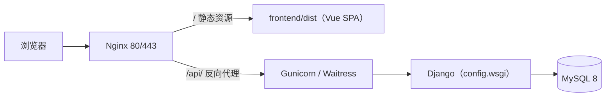

# 04 - 多平台部署指南

> 本文档给出本项目在生产环境的部署方案：Linux（Nginx + Gunicorn + systemd）、Windows Server（Waitress）、Docker / docker-compose、云平台与对象存储/CDN。
> 配套：[00-文档导航](./00-文档导航.md) · [01-项目结构与调用关系](./01-项目结构与调用关系.md) · [02-功能说明文档](./02-功能说明文档.md) · [03-运行启动指南](./03-运行启动指南.md) · [05-Java开发者零基础学习路线](./05-Java开发者零基础学习路线.md)

---

## 1. 部署总体架构



要点：

- 前端是 SPA，Nginx 必须配置 `try_files $uri $uri/ /index.html`，否则刷新子路由 404。
- 前端 `utils/request.js` 的 baseURL 是 `/api`，因此**推荐前后端同域部署**（Nginx 同站反代 `/api`）。
- 若前端放对象存储/CDN、后端单独域名，需要把 request.js 的 baseURL 改成完整后端地址，并在后端配置 CORS 白名单。

---

## 2. 生产配置清单（必做）

| 项 | 要求 |
|---|---|
| `DEBUG` | `False` |
| `SECRET_KEY` | 更换为随机长字符串（建议从环境变量读取） |
| `ALLOWED_HOSTS` | 填写实际域名/IP，禁止 `['*']` |
| `CORS_ALLOW_ALL_ORIGINS` | `False`，使用白名单（`CORS_ALLOWED_ORIGINS` / 自定义中间件） |
| 数据库账号 | 最小权限（仅 `gen_admin` 的 SELECT/INSERT/UPDATE/DELETE，DDL 单独账号） |
| `TIME_ZONE` | `Asia/Shanghai`（与业务一致） |
| 日志 | 配置 `logging` 输出到文件并轮转；Gunicorn/Nginx 日志单独留存 |
| 静态文件 | 若使用 DRF 可浏览页面，配置 `STATIC_ROOT` 并执行 `collectstatic` |
| 备份 | MySQL 每日 `mysqldump` + 定期恢复演练 |
| 安全 | 仅暴露 80/443；8000 只监听 127.0.0.1；启用 HTTPS |

> `requirements.txt` 只包含运行依赖，**生产需要额外安装** `gunicorn`（Linux）或 `waitress`（Windows）。

---

## 3. 方案一：Linux（Ubuntu / CentOS）+ Nginx + Gunicorn + systemd

### 3.1 安装依赖

Ubuntu：

```bash
sudo apt update
sudo apt install -y python3 python3-venv python3-pip nginx mysql-server
```

CentOS：

```bash
sudo yum install -y python3 python3-devel nginx mysql-server
```

### 3.2 部署后端

```bash
# 假设代码在 /opt/django-base-admin
cd /opt/django-base-admin/backend
python3 -m venv venv
source venv/bin/activate
pip install -r requirements.txt
pip install gunicorn

# 生产配置：编辑 config/settings.py（DEBUG=False、ALLOWED_HOSTS、数据库、SECRET_KEY）

# 初始化数据库（先修改 init_db.py 的 SQL_FILE 为 /opt/django-base-admin/docs/后台管理系统-初始化建表SQL.sql）
python manage.py check
python manage.py init_db

# 测试启动
gunicorn config.wsgi:application --bind 127.0.0.1:8000 --workers 4 --timeout 120
```

### 3.3 systemd 托管

`/etc/systemd/system/django-admin.service`：

```ini
[Unit]
Description=Django Admin (Gunicorn)
After=network.target mysql.service

[Service]
Type=simple
User=www-data
Group=www-data
WorkingDirectory=/opt/django-base-admin/backend
Environment="PATH=/opt/django-base-admin/backend/venv/bin"
ExecStart=/opt/django-base-admin/backend/venv/bin/gunicorn config.wsgi:application \
    --bind 127.0.0.1:8000 --workers 4 --timeout 120 --access-logfile - --error-logfile -
Restart=always
RestartSec=5

[Install]
WantedBy=multi-user.target
```

```bash
sudo systemctl daemon-reload
sudo systemctl enable --now django-admin
sudo systemctl status django-admin
```

### 3.4 构建前端

```bash
cd /opt/django-base-admin/frontend
npm ci
npm run build          # 产物：frontend/dist
```

### 3.5 Nginx 配置

`/etc/nginx/conf.d/django-admin.conf`：

```nginx
server {
    listen 80;
    server_name admin.example.com;

    root /opt/django-base-admin/frontend/dist;
    index index.html;

    client_max_body_size 20m;
    gzip on;
    gzip_types text/plain text/css application/json application/javascript image/svg+xml;

    # SPA：所有前端路由回退到 index.html
    location / {
        try_files $uri $uri/ /index.html;
    }

    # 后端 API：保留 /api 前缀转发
    location /api/ {
        proxy_pass http://127.0.0.1:8000;
        proxy_set_header Host $host;
        proxy_set_header X-Real-IP $remote_addr;
        proxy_set_header X-Forwarded-For $proxy_add_x_forwarded_for;
        proxy_set_header X-Forwarded-Proto $scheme;
        proxy_read_timeout 120s;
    }
}
```

```bash
sudo nginx -t
sudo systemctl reload nginx
```

> 注意：`proxy_pass http://127.0.0.1:8000;` 末尾**不要加 `/`**，否则 `/api/auth/login` 会被改写成 `/auth/login`，导致 404。

### 3.6 HTTPS

使用 Certbot：

```bash
sudo apt install -y certbot python3-certbot-nginx
sudo certbot --nginx -d admin.example.com
```

或使用云厂商证书，在 Nginx 中配置 443 与证书路径，并强制 80 → 443 跳转。

---

## 4. 方案二：Windows Server

### 4.1 后端：Waitress + NSSM

```powershell
cd d:\django-base-admin\backend
.\venv\Scripts\Activate.ps1
pip install -r requirements.txt
pip install waitress

# 测试启动
waitress-serve --listen=127.0.0.1:8000 config.wsgi:application
```

使用 [NSSM](https://nssm.cc/) 注册为服务：

```powershell
nssm install DjangoAdmin "d:\django-base-admin\backend\venv\Scripts\waitress-serve.exe" "--listen=127.0.0.1:8000 config.wsgi:application"
nssm set DjangoAdmin AppDirectory "d:\django-base-admin\backend"
nssm start DjangoAdmin
```

### 4.2 前端与反向代理

- 前端执行 `npm run build`，产物 `frontend\dist`。
- 使用 Nginx for Windows 或 IIS + ARR：
  - 静态目录指向 `frontend\dist`，SPA 回退到 `index.html`；
  - `/api/` 反向代理到 `http://127.0.0.1:8000`，保留路径前缀；
  - IIS 可使用「URL Rewrite + Application Request Routing」实现。

Nginx for Windows 配置与第 3.5 节一致，只需把 `root` 改成 Windows 路径。

> 也可用 `gunicorn` 在 Windows 上（依赖 `fcntl` 等问题较多），推荐 Waitress。

---

## 5. 方案三：Docker / docker-compose

### 5.1 后端 Dockerfile（`backend/Dockerfile`）

```dockerfile
FROM python:3.12-slim

ENV PYTHONDONTWRITEBYTECODE=1 \
    PYTHONUNBUFFERED=1

WORKDIR /app

RUN apt-get update && apt-get install -y --no-install-recommends \
    build-essential default-libmysqlclient-dev curl \
    && rm -rf /var/lib/apt/lists/*

COPY requirements.txt .
RUN pip install --no-cache-dir -r requirements.txt gunicorn

COPY . .

EXPOSE 8000
CMD ["gunicorn", "config.wsgi:application", "--bind", "0.0.0.0:8000", "--workers", "4", "--timeout", "120"]
```

### 5.2 前端 Dockerfile（`frontend/Dockerfile`，多阶段）

```dockerfile
FROM node:20-alpine AS build
WORKDIR /app
COPY package*.json ./
RUN npm ci
COPY . .
RUN npm run build

FROM nginx:1.27-alpine
COPY --from=build /app/dist /usr/share/nginx/html
COPY nginx.conf /etc/nginx/conf.d/default.conf
EXPOSE 80
```

`frontend/nginx.conf`：

```nginx
server {
    listen 80;
    root /usr/share/nginx/html;
    index index.html;
    client_max_body_size 20m;

    location / {
        try_files $uri $uri/ /index.html;
    }
    location /api/ {
        proxy_pass http://backend:8000;
        proxy_set_header Host $host;
        proxy_set_header X-Real-IP $remote_addr;
        proxy_set_header X-Forwarded-For $proxy_add_x_forwarded_for;
    }
}
```

### 5.3 docker-compose.yml（项目根目录）

```yaml
services:
  mysql:
    image: mysql:8.0
    command: --default-authentication-plugin=mysql_native_password
    environment:
      MYSQL_ROOT_PASSWORD: root123456
      MYSQL_DATABASE: gen_admin
      TZ: Asia/Shanghai
    volumes:
      - mysql_data:/var/lib/mysql
      - ./docs/后台管理系统-初始化建表SQL.sql:/docker-entrypoint-initdb.d/init.sql:ro
    healthcheck:
      test: ["CMD", "mysqladmin", "ping", "-h", "127.0.0.1", "-proot123456"]
      interval: 10s
      timeout: 5s
      retries: 10

  backend:
    build: ./backend
    environment:
      MYSQL_HOST: mysql
      MYSQL_PORT: "3306"
      MYSQL_USER: root
      MYSQL_PASSWORD: root123456
      MYSQL_DB: gen_admin
    depends_on:
      mysql:
        condition: service_healthy
    volumes:
      - ./docs:/app/docs:ro
    expose:
      - "8000"

  frontend:
    build: ./frontend
    ports:
      - "80:80"
    depends_on:
      - backend

volumes:
  mysql_data:
```

说明：

1. `settings.py` 当前数据库配置是硬编码的。容器部署时建议改为读取环境变量（`os.environ.get`），否则需在镜像构建前修改。
2. `init_db.py` 的 `SQL_FILE` 同样需要指向容器内路径（如 `/app/docs/后台管理系统-初始化建表SQL.sql`），或改为环境变量。
3. 首次启动后进入 backend 容器执行 `python manage.py init_db`，完成菜单与管理员初始化：

```bash
docker compose exec backend python manage.py init_db
```

4. 生产环境请把 MySQL 密码、`SECRET_KEY` 放入 `.env` 或密钥管理，不要提交到仓库。

---

## 6. 方案四：云平台

### 6.1 云服务器（ECS/CVM）

1. 安全组放通 80/443（数据库 3306 不对外开放）；
2. 按「方案一」安装 Python、Nginx、MySQL；
3. 域名解析 A 记录到服务器 IP；
4. Certbot 或云厂商证书配置 HTTPS；
5. 使用 systemd 托管 Gunicorn，Nginx 反代并托管 `dist`。

### 6.2 宝塔面板

1. 安装 Nginx、MySQL 8、Python 项目管理器；
2. 后端用「Python 项目」创建，启动命令
   `gunicorn config.wsgi:application --bind 127.0.0.1:8000 --workers 4`；
3. 前端 `npm run build` 后把 `dist` 放到站点根目录；
4. 站点配置 `location /api/ { proxy_pass http://127.0.0.1:8000; }` 与 SPA 回退；
5. 面板申请 SSL 并强制 HTTPS。

### 6.3 容器服务 / Kubernetes

- 构建 backend 与 frontend 镜像推送到镜像仓库；
- 使用 Deployment + Service（ClusterIP）+ Ingress；
- MySQL 使用云数据库 RDS（推荐），通过 Secret 注入连接信息；
- 配置存活/就绪探针（`/api/auth/userinfo` 需登录，不适合探针；可加一个匿名健康检查接口或使用 TCP 探针）。

### 6.4 前端对象存储 + CDN（可选）

1. `npm run build` 后将 `dist` 上传到 OSS/COS，开启静态网站托管与 CDN；
2. 绑定前端域名并配置 HTTPS；
3. 修改 `utils/request.js` 的 baseURL 为后端完整地址（如 `https://api.example.com/api`）；
4. 后端 `CORS_ALLOWED_ORIGINS` 加入前端域名；
5. 注意前端 SPA 的 404 回退：对象存储静态托管通常支持「默认首页 + 404 回退 index.html」，需在控制台配置。

---

## 7. 数据库备份与恢复

### 7.1 备份

```bash
# 每日备份（Linux crontab）
mysqldump -u root -p --single-transaction --routines --triggers gen_admin \
  | gzip > /backup/gen_admin_$(date +%F).sql.gz
```

```powershell
# Windows
mysqldump -u root -p --single-transaction gen_admin > D:\backup\gen_admin_%date%.sql
```

### 7.2 恢复

```bash
gunzip < /backup/gen_admin_2026-11-03.sql.gz | mysql -u root -p gen_admin
```

### 7.3 建议

- 备份文件异地存储（OSS/S3/另一台服务器）；
- 变更前手动备份；
- 每季度做一次恢复演练。

---

## 8. 上线流程与回滚

### 8.1 上线流程

1. 代码合并 → 构建前端 `npm run build`；
2. 备份数据库；
3. 更新后端代码 → 安装新依赖 → `python manage.py check` → 重启服务；
4. 同步前端 `dist`；
5. 冒烟测试：登录、用户列表、代码生成、生成模块 CRUD；
6. 观察日志 10 分钟（5xx、异常栈、慢查询）。

### 8.2 回滚

- 代码：保留上一版本目录或镜像 tag，直接切回并重启；
- 数据库：按变更前备份恢复（注意评估数据丢失范围）；
- 前端：保留上一版 `dist` 备份，直接替换。

---

## 9. 日志与监控

| 日志 | 位置/方式 |
|---|---|
| Gunicorn 访问/错误 | systemd journal（`journalctl -u django-admin -f`）或日志文件 |
| Django 异常 | `logging` 配置 + 中间件 `logger.exception` |
| Nginx | `/var/log/nginx/access.log`、`error.log` |
| 业务操作 | `sys_oper_log`、`sys_login_log` 表（后台可查） |
| 数据库慢查询 | MySQL `slow_query_log` |

建议接入云监控/告警（CPU、内存、磁盘、5xx 比例、接口耗时）。

---

## 10. 部署后验收清单

- [ ] 首页 `https://域名/` 正常打开，刷新子路由不 404
- [ ] 登录成功，菜单与权限正确
- [ ] `/api/auth/login` 返回 200 业务码，响应头有 `X-Refresh-Token`（临近过期时）
- [ ] 用户/角色/菜单/部门/字典/配置/日志页面可用
- [ ] 代码生成导入、预览、下载可用
- [ ] 生成模块 CRUD、导入、导出可用
- [ ] 上传/下载大小限制符合预期
- [ ] HTTPS 证书有效，HTTP 自动跳转 HTTPS
- [ ] 数据库备份任务已生效
- [ ] 服务器重启后服务自动拉起（systemd/NSSM 已 enable）

---

## 11. 常见故障排查

| 现象 | 排查方向 |
|---|---|
| 502 Bad Gateway | 后端未启动/端口不对；`systemctl status`、Gunicorn 日志 |
| 504 Gateway Timeout | 接口耗时过长；Gunicorn `--timeout`、SQL 慢查询 |
| 静态资源 404 / 白屏 | Nginx `root` 指向 dist；SPA 回退配置；CDN 缓存 |
| API 404 | `proxy_pass` 末尾是否多了 `/`；前端路径是否带 `/api` 前缀 |
| CORS 报错 | 前后端域名不同；后端 CORS 白名单；预检 OPTIONS |
| 中文乱码 | 数据库字符集 `utf8mb4`；响应头/Excel 导出编码 |
| 时间差 8 小时 | `TIME_ZONE`、MySQL 时区、服务器时区 |
| 登录后立刻 401 | 系统时间偏差导致 JWT 过期；NTP 同步 |
| 生成模块报 `Table doesn't exist` | 建表 SQL 未执行/库名不一致 |
| 修改配置不生效 | Gunicorn/Waitress 需要重启；确认加载的是新代码 |

---

## 12. 附：最小化生产检查脚本（Linux）

```bash
cd /opt/django-base-admin/backend
source venv/bin/activate

python manage.py check --deploy
sudo nginx -t
sudo systemctl status django-admin --no-pager
curl -s -o /dev/null -w "%{http_code}\n" https://admin.example.com/
```

> `--deploy` 会提示 DEBUG、SECRET_KEY、ALLOWED_HOSTS、HTTPS 等安全项，按提示逐项修复。
