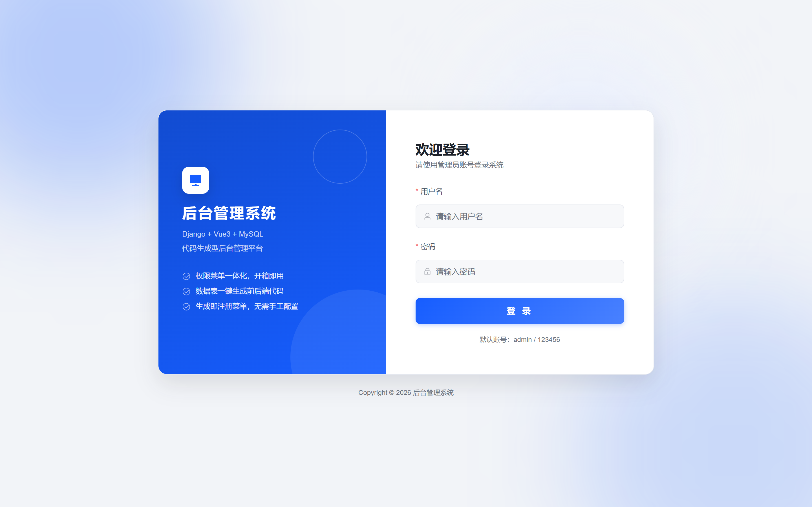
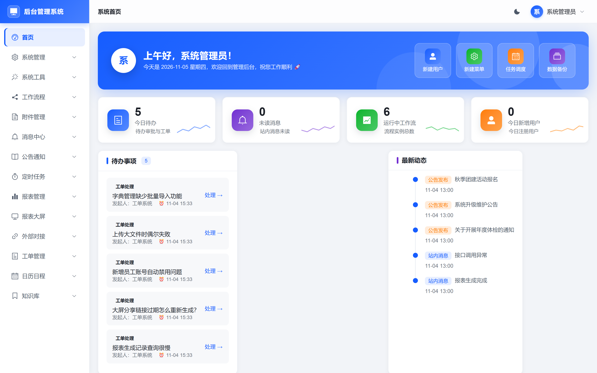
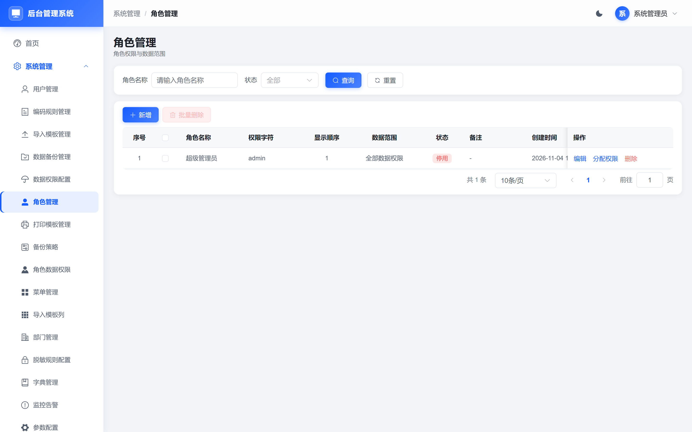
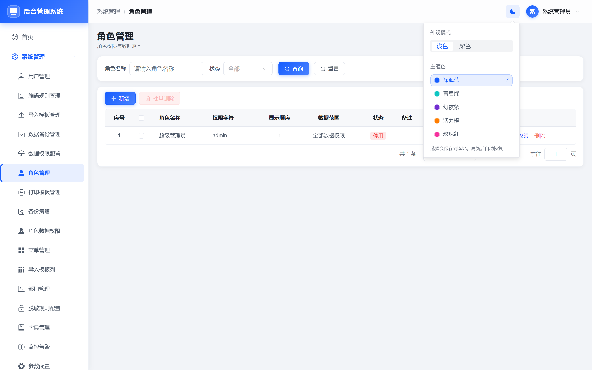
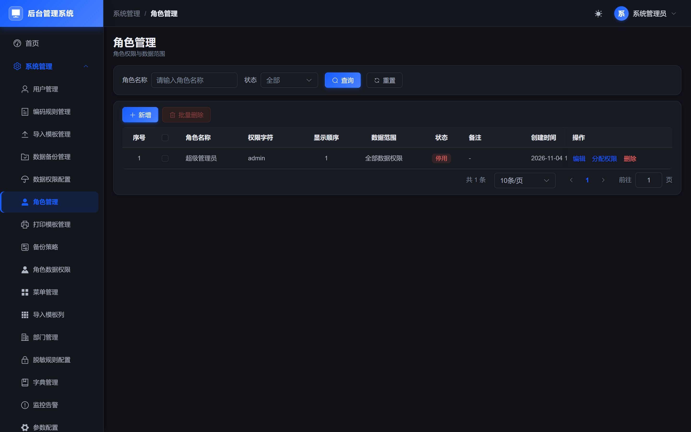
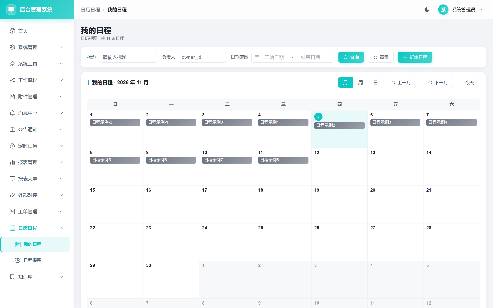
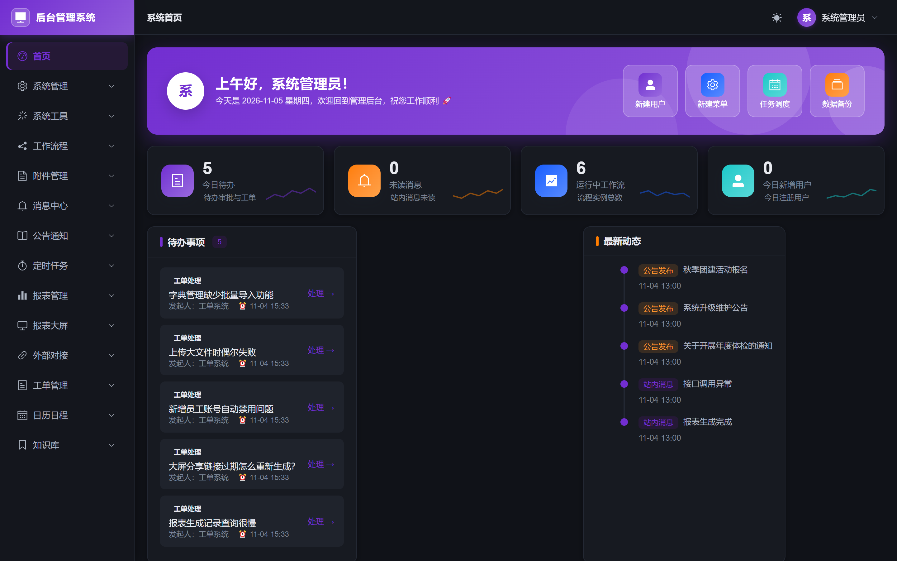

# 前端 UI 深度优化与多主题改造报告

> 范围：`frontend/`（Vue 3 + Vite 5 + Element Plus 2.9）
> 约束：不改后端、不改接口契约、不改业务行为与权限规则（`v-perm`、动态路由、请求封装全部保持不变）

## 一、结论先行

1. **没有做整站 Arco 重写**，而是采用「设计令牌 + 全局组件皮肤 + 主题运行时」方案：一套 CSS 变量同时驱动 Element Plus、Arco Design 和自研样式，**所有列表/表单/弹窗/详情页面零改动即跟随新视觉**。这样既统一了观感，又避免 40+ 页面逐页替换控件带来的回归风险。
2. **新增依赖** `@arco-design/web-vue@^2.59.0`：仅顶栏主题面板按需引入 `Popover / RadioGroup / Radio`（JS 按需），并引入其暗色变量；业务控件继续使用项目原有的 Element Plus。
3. **主题系统**：明暗两种模式 + **5 套主题色**，顶栏入口，`localStorage` 持久化，切换即时生效；表格、弹窗、图表、暗色边框全部跟随，没有局部硬编码色。
4. **构建与验证**：`npm run build` exit 0；18 个重点页面 + 同类页面回归通过，搜索/分页/新增编辑弹窗/主题切换/暗色模式可用，控制台无报错。

**观感提升点**

| 区域 | 改造前 | 改造后 |
| --- | --- | --- |
| 列表页 | 卡片与表格各自为政，表头灰、行距松散、操作按钮换行 | 统一 12px 卡片圆角 + 柔和阴影；表头 42px、单元格 12px 内边距、悬停高亮、操作列不换行 |
| 查询区 | 表单间距大、按钮不齐 | 紧凑栅格（右 14px / 下 12px），label 与控件对齐 |
| 按钮 | 尺寸、圆角、层级不统一 | 32/40/26 三档尺寸；主按钮品牌渐变 + 品牌色投影，次按钮 hover 品牌色 |
| 状态表达 | 纯文字或颜色各异 | 统一 `.el-tag` 软底标签 + `.status-dot` 状态圆点 |
| 空数据 | 只有一行灰字 | 表格内置线性插画空状态（暗色单独配色） |
| 弹窗/抽屉 | 直角、无明显分区 | 16px 圆角、标题/内容/底部三区分隔线、遮罩轻微模糊 |
| 全局框架 | 菜单/面包屑/登录页存在写死颜色 | 侧边栏、顶栏、面包屑、登录页、首页全部 token 化 |
| 暗色 | 无 | 语义变量整体替换，边框与表面层次分明，文字对比度达标 |

## 二、主题清单与切换方式

| key | 名称 | 主色 | 图表主色（--chart-1） |
| --- | --- | --- | --- |
| `blue` | 深海蓝 | `#165dff` | `#165dff` |
| `teal` | 青碧绿 | `#0fc6c2` | `#0fc6c2` |
| `purple` | 幻夜紫 | `#722ed1` | `#722ed1` |
| `orange` | 活力橙 | `#ff7d00` | `#ff7d00` |
| `rose` | 玫瑰红 | `#f5319d` | `#f5319d` |

**切换入口**：顶栏右侧「主题设置」按钮（太阳/月亮图标）→ 弹出面板

- 外观模式：浅色 / 深色
- 主题色：上述 5 套，选中项高亮并显示 ✓

**持久化**：`localStorage["app-theme"] = {"mode":"dark","palette":"purple"}`。`initTheme()` 在 `app.mount()` 之前恢复并应用，刷新不闪烁、不丢失。

**实现机制**

- 明暗：`html.dark`（Element Plus 暗色变量）+ `body[arco-theme="dark"]`（Arco 暗色）
- 主题色：运行时写入 `--el-color-primary` 及 `-light-3/5/7/8/9`、`--primary-1..10`、`--brand-*`、`--chart-1..6`
- 暗色梯度：浅色梯度向 `#141414` 混合，避免暗底上出现刺眼的浅色块
- 图表：`SimpleChart.vue` 直接引用 `var(--chart-N)` / `var(--app-border-light)`，SVG 属性天然支持 CSS 变量，切换即重绘

## 三、设计规范（已沉淀为全局变量）

| 类别 | 变量 | 说明 |
| --- | --- | --- |
| 主色 | `--brand-primary / -hover / -soft / -border / -gradient / -glow` | 由主题运行时写入 |
| 语义色 | `--app-success / warning / danger / info` | 暗色下整体提亮 |
| 文本 | `--app-text-1..4` | 主/次/辅助/占位，暗色单独定义 |
| 表面 | `--app-bg / surface / surface-2 / surface-3 / sidebar-bg / header-bg / overlay` | 页面、卡片、分组、侧栏、顶栏、遮罩 |
| 边框 | `--app-border / -light / -strong` | 暗色自动降低亮度 |
| 圆角 | `--app-radius-xs..xl`（4/6/8/12/16） | 按钮/输入/卡片/弹窗统一 |
| 间距 | `--app-space-1..6`（4~24） | 页面、卡片、工具栏 |
| 字号 | `--app-font-xs..xl`（12/13/14/15/18/22） | 标题、正文、辅助、按钮 |
| 阴影 | `--app-shadow-xs..lg` | 卡片、悬浮、弹窗 |
| 表格密度 | `--app-table-head-h / row-h / cell-px / head-bg / stripe / hover` | 表头 42px、单元格 12px |
| 图表 | `--chart-1..6` | 5 套色板各自配套 |

暗色只替换 `tokens.css` 中 `html.dark` 的语义变量，组件样式无需重写。

## 四、主要改造清单（文件 + 改动要点）

### 新增文件

| 文件 | 改动要点 |
| --- | --- |
| `frontend/src/theme/index.js` | 主题状态、5 套色板、颜色混合、运行时变量写入、localStorage 恢复/监听、`initTheme` |
| `frontend/src/styles/tokens.css` | 全局设计令牌 + 暗色语义变量覆盖 |
| `frontend/src/components/ThemeSwitch.vue` | Arco Popover + RadioGroup 主题面板，内联 SVG 太阳/月亮图标，5 色板选择 |

### 修改文件

| 文件 | 改动要点 |
| --- | --- |
| `frontend/src/main.js` | 引入 EP 暗色 css、`arco.css`、全局样式；`initTheme()` 先于 `mount` |
| `frontend/src/styles/index.css` | 全局组件皮肤：卡片/查询区/工具栏/按钮/输入/表格/空状态 SVG/分页/弹窗/抽屉/表单/标签/描述列表/消息提示/滚动条；新增键盘焦点环与 `prefers-reduced-motion` 支持 |
| `frontend/src/layout/components/Navbar.vue` | 接入主题切换入口；面包屑、用户入口、头像渐变 token 化 |
| `frontend/src/layout/components/Sidebar.vue` | 菜单取色 token 化，logo 品牌渐变，hover/active 品牌软底 + 左侧高亮条 |
| `frontend/src/layout/index.vue` | 侧栏/顶栏/主区背景与阴影 token 化，顶栏半透明 + 模糊 |
| `frontend/src/components/chart/SimpleChart.vue` | 删除明暗硬编码色板，改为 `--chart-*` / `--app-*`，饼图中心孔跟随表面色 |
| `frontend/src/views/login/index.vue` | 背景光晕、卡片、左侧品牌渐变、输入框 focus、登录按钮全部 token 化 |
| `frontend/src/views/dashboard/index.vue` | hero 横幅、统计卡、待办/动态/监控/常用功能卡片 token 化；迷你走势线与快捷入口图标改为 `--chart-*` |
| `frontend/src/views/kb/document/index.vue` | 文档卡片、标签色、统计卡渐变全部 token 化 |
| `frontend/src/views/kb/category/index.vue`、`student/index.vue`、`workflow/model/design.vue`、`wo/mine/index.vue`、`wo/order/index.vue`、`cal/schedule/index.vue` | 样式段硬编码色批量替换为 token；日历事件色块改为 `--chart-*` 与 `color-mix`，暗色不再出现白色渐变端点 |
| `frontend/package.json` | 新增 `@arco-design/web-vue ^2.59.0` |

**同类页面覆盖**：所有列表页、表单弹窗、详情页复用的 `el-table / el-form / el-dialog / el-pagination / el-tag / el-descriptions` 均由全局样式统一改造，无需逐页修改；上一轮验证过的 18 个页面全部包含在内。

## 五、构建与验证结果

### 构建

```
npm run build
✓ 2816 modules transformed
✓ built in 20.83s
dist/assets/index-*.js   1,321.39 kB │ gzip: 427.03 kB
dist/assets/index-*.css    789.89 kB │ gzip: 102.49 kB
```

- 退出码 **0**，无编译错误；仅有 chunk >500 kB 的体积提示（Element Plus + Arco 全量 CSS），见「后续建议」。
- Arco 仅按需引入 3 个 JS 组件，未显著增加 JS 体积；CSS 为全量引入（供暗色变量）。

### 逐页验证（真实浏览器，登录 admin/123456）

| 验证项 | 结果 | 证据 |
| --- | --- | --- |
| 首页 `/dashboard` 浅色 | PASS | hero 横幅、4 张统计卡、待办、动态、监控、常用功能均正常 |
| 角色列表 `/system/role` 浅色/深色 | PASS | 表格、分页、查询区、新增/编辑弹窗正常；暗色下边框与文字对比清晰 |
| `/msg/config`、`/system/tenant`、`/wo/order` 深色 | PASS | 渲染正常，无 404/500 |
| 登录页浅色/深色 | PASS | 卡片、左侧渐变、表单校验、登录跳转正常 |
| 搜索 / 分页 / 新增编辑弹窗 | PASS | 列表交互可用，弹窗表单校验正常 |
| 明暗切换 | PASS | 深色 `body` 背景 `rgb(16,18,24)`、正文 `rgb(232,234,240)`；切回浅色正常 |
| 主题色切换 | PASS | 紫色下 `--el-color-primary = #722ed1`；青绿下 SVG 图表 computed fill = `rgb(15,198,194)` |
| 刷新保持 | PASS | `localStorage["app-theme"]` 恢复，首屏无闪烁 |
| 图表跟随 | PASS | 折线/柱状/饼图/仪表盘/排名条颜色随主题变化 |
| 日历页改造后复测 | PASS | `/cal/schedule` 浅色/深色网格与事件芯片可见、芯片文字纯白、控制台无报错 |
| 控制台 | PASS | 各页面均无报错 |

### 视觉验收（Playwright 自动采集，2× @ 1440×900）

截图落盘于 `docs/设计稿或截图/界面截图/ui/`，全部为改造后的实际运行画面。

**① 登录页** — 左侧品牌渐变区 + 右侧表单卡片 + 三层光晕，全部 token 化，主题切换时实时跟随。



**② 仪表盘（浅色）** — hero 横幅、4 张渐变统计卡、迷你走势线、待办/动态/监控/常用功能面板。



**③ 角色列表（浅色）** — 查询区紧凑排布、工具栏主次按钮层级、表格表头 42px、操作列不换行、分页品牌色。



**④ 主题设置面板** — 顶栏入口，浅色/深色切换 + 5 套主题色（蓝/青绿/紫/橙/玫瑰），选中项品牌软底 + ✓ 标记。



**⑤ 角色列表（深色）** — 同一页面切深色后，语义变量整体替换，边框与表面层次分明、表格悬停高亮仍清晰、文字对比度达标。



**⑥ 日历页（青碧绿主题）** — 切换到 teal 主题色后，事件色块从蓝变为青绿渐变，视觉整体协调。



**⑦ 仪表盘（深色 + 紫色主题）** — 深紫混搭，`html.dark` 语义变量替换 + 主题色运行时写入双重驱动。



## 六、未覆盖与后续建议

| 项 | 说明 | 建议 |
| --- | --- | --- |
| Arco 全量控件迁移 | 本轮 Arco 仅用于主题面板；业务控件仍在 Element Plus | 若确定整站迁 Arco，需逐页替换 Table/Form/Modal 并回归权限与交互，建议分批进行 |
| 查询区折叠/展开 | 全局样式已紧凑，但未加「展开更多」交互 | 查询条件超过 4 项的表单可二次封装折叠容器 |
| 表格加载骨架 | 目前为统一 loading 遮罩 | 可加 `v-loading` 下的骨架行，提升大表首屏观感 |
| 长表单抽屉化 | 弹窗已统一分区与尺寸，未改结构 | 字段超过 12 项的表单建议改 `el-drawer` 或分步 |
| 大屏页 `bi/screen/view.vue` | 自带全屏暗色设计，未纳入明暗切换 | 作为独立展示页保留，或提供显式「大屏主题」开关 |
| 体积优化 | 主 JS 1.32 MB、CSS 790 kB | 用 `manualChunks` 拆分 Element Plus / bpmn-js；Arco 若只用主题面板可改按需 CSS |
| 可访问性 | 已补焦点环、减少动效、次要文字对比度（#6b7280，白底约 4.8:1） | 后续可做表格排序/弹窗焦点的键盘走查 |

## 七、其他说明

- 本轮参考 uicraft 规范补做了三项可访问性收口：键盘 `:focus-visible` 焦点环、`prefers-reduced-motion` 降级、次要文字对比度达标。
- 业务页面中残留的少量 `#fff` 均为「有主色/渐变底上的前景文字」或品牌 logo 白底，属于有意保留；暗色下不影响可读性。
- 权限指令 `v-perm`、动态路由 `import.meta.glob('../views/**/*.vue')`、`utils/request` 封装均未改动。
- 依赖新增：`@arco-design/web-vue@^2.59.0`（用于主题面板）；`playwright` 仅用于截图与验收采集，未加入项目依赖。
- 逐项验收数据、主题矩阵与交互用例详见 [UI 验收报告](ui-acceptance-report.md)。
