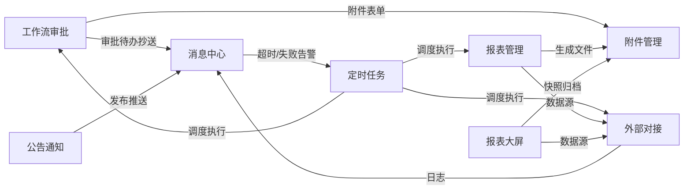

# 02 - 功能说明文档

> 本文档说明系统**每个功能点的页面位置、接口、权限标识、业务规则与验收方法**。
> 配套：[00-文档导航](../00-文档导航.md) · [01-项目结构与调用关系](./01-项目结构与调用关系.md) · [03-运行启动指南](./03-运行启动指南.md) · [04-多平台部署指南](./04-多平台部署指南.md) · [05-Java开发者零基础学习路线](./05-Java开发者零基础学习路线.md)

---

## 1. 系统总览

### 1.1 角色与账号

| 角色 | 说明 |
|---|---|
| 超级管理员 `admin` | 拥有 `*:*:*` 通配权限，可见全部菜单与按钮 |
| 普通角色 | 由管理员在「角色管理」中分配菜单/按钮权限 |

默认账号：`admin / 123456`（由 `python manage.py init_db` 写入，bcrypt 加密）。

### 1.2 菜单结构

```
首页（/dashboard）
系统管理（/system）
  ├ 用户管理      /system/user
  ├ 角色管理      /system/role
  ├ 菜单管理      /system/menu
  ├ 部门管理      /system/dept
  ├ 字典管理      /system/dict
  ├ 参数配置      /system/config
  ├ 操作日志      /system/operlog
  └ 登录日志      /system/loginlog
系统工具（/gen）
  └ 代码生成      /gen/table
工作流程（/workflow）
  ├ 流程管理      /workflow/manage
  │  ├ 流程分类    /workflow/manage/category
  │  ├ 流程模型    /workflow/manage/model
  │  ├ 流程表单    /workflow/manage/form
  │  ├ 用户分组    /workflow/manage/group
  │  ├ 流程监听器  /workflow/manage/listener
  │  └ 流程表达式  /workflow/manage/expression
  ├ 审批中心      /workflow/center
  │  ├ 发起流程    /workflow/center/start
  │  ├ 我的流程    /workflow/center/my
  │  ├ 待办任务    /workflow/center/todo
  │  ├ 已办任务    /workflow/center/done
  │  └ 抄送我的    /workflow/center/cc
  └ OA示例        /workflow/oa
     └ 请假查询    /workflow/oa/leave
生成的业务菜单（示例：学生信息 /student）
附件管理（/file）
  ├ 附件列表      /file/index
  ├ 上传配置      /file/config
  ├ 预览配置      /file/preview
  └ 附件回收站    /file/recycle
消息中心（/msg）
  ├ 消息模板      /msg/template
  ├ 站内消息      /msg/record
  ├ 消息推送记录  /msg/push_log
  └ 推送配置      /msg/push_config
公告通知（/notice）
  ├ 公告列表      /notice/index
  └ 公告分类      /notice/category
定时任务（/task）
  ├ 任务列表      /task/index
  └ 任务日志      /task/log
报表管理（/rp）
  ├ 报表设计      /rp/template
  ├ 报表生成      /rp/generate
  ├ 报表查询      /rp/query
  └ 报表实时查询  /rp/realtime
报表大屏（/bi）
  ├ 大屏设计      /bi/design
  ├ 大屏管理      /bi/index
  └ 大屏访问记录  /bi/visit_log
外部对接（/outer）
  ├ 接口配置      /outer/api_config
  ├ 请求日志      /outer/request_log
  └ 数据同步任务  /outer/sync_task
```

> 侧边栏对三级菜单做了层级缩进：一级菜单 14px、二级菜单 34px、三级页面 64px，使「工作流程 → 流程管理/审批中心/OA示例 → 具体页面」的从属关系清晰可见。

> 生成模块的菜单由代码生成器写入 `sys_menu`，登录或刷新后自动出现在侧边栏。

---

## 2. 通用机制

| 机制 | 说明 | 位置 |
|---|---|---|
| 统一响应 | `{code, msg, data}`，HTTP 状态恒 200；成功 `code=200` | `common/response.py` |
| JWT | HS256，2 小时；剩余 30 分钟时响应头返回 `X-Refresh-Token` 静默续期 | `common/auth.py`、`common/middleware.py` |
| 密码 | bcrypt 哈希存储 | `common/utils.py` |
| 登录态 | 前端 `localStorage` 保存 token，`fetchUserinfo` 获取用户/权限/菜单 | `store/auth.js` |
| 按钮权限 | `v-perm="'system:user:create'"`，无权限隐藏按钮 | `directive/perm.js` |
| 后端权限 | `PermissionCheck` 根据 `perm_map`（action → 权限标识）校验 | `common/permissions.py` |
| 逻辑删除 | 所有删除操作把 `is_deleted` 置 1；查询过滤 `is_deleted=0` | `CrudViewSet`、各模型 |
| 分页 | `page`、`page_size`，返回 `{list, total}` | `common/pagination.py` |
| 操作日志 | 中间件自动记录写操作（模块/类型/URL/参数/结果/耗时） | `common/middleware.py` |
| 登录日志 | 登录成功/失败均落库，记录 IP、UA、状态 | `views/auth.py` |
| 字典缓存 | 前端缓存 `/system/dict/data/all` 结果，`dictLabel(type, value)` 翻译标签 | `utils/dict.js` |
| 动态路由 | 后端菜单 → 前端 `addRoute`；支持三级菜单递归注册，刷新后守卫重新注册 | `router/index.js` |
| 三级菜单 | 侧边栏父/子菜单逐级缩进（14 / 34 / 64px），体现层级从属关系 | `layout/components/Sidebar.vue` |
| 主题 | Element Plus CSS 变量覆盖 + 全局工具类 | `styles/index.css` |

---

## 3. 逐模块功能说明

### 3.1 登录认证

- **页面**：`/login`（[views/login/index.vue](../../frontend/src/views/login/index.vue)）
- **功能**：账号密码登录；成功后保存 token 并跳转 `/dashboard`（支持 `redirect` 参数）；退出登录清理本地状态与动态路由。
- **业务规则**：
  - 用户名/密码必填；
  - 停用用户（`status=True`）禁止登录；
  - 登录成功/失败均写 `sys_login_log`；
  - token 过期或 401 时，前端清理登录态并跳转登录页。
- **接口**：

| 方法 | 路径 | 参数 | 返回 |
|---|---|---|---|
| POST | `/api/auth/login` | `{username, password}` | `{token, user, perms, menus}` |
| GET | `/api/auth/userinfo` | Header Bearer | `{user, perms, menus}` |
| DELETE | `/api/auth/logout` | Header Bearer | `null` |

- **验收**：错误密码提示；停用用户无法登录；登录后侧边栏出现有权限的菜单。

### 3.2 首页 Dashboard

- **页面**：`/dashboard`
- **功能**：问候语横幅、快捷入口卡片（用户/菜单/部门/代码生成）、系统简介与使用流程。
- **数据**：当前为前端静态展示（不依赖统计接口）。
- **验收**：登录后默认进入，卡片可跳转对应模块。

### 3.3 用户管理

- **页面**：`/system/user`
- **功能**：条件查询（用户名/昵称/手机号/状态/部门）、分页、新增、编辑、删除、批量删除、重置密码、分配角色、状态开关。
- **业务规则**：
  - 用户名唯一（排除逻辑删除）；
  - 新增时未填密码默认 `123456`；
  - **不能修改自己的状态**（前端禁用开关并提示，后端返回 `code=400`）；
  - 状态字段：数据库 `BooleanField`（False=正常），列表接口输出 0/1 供前端开关；
  - 删除为逻辑删除，同时清理用户-角色关联。
- **接口**：

| 方法 | 路径 | 关键参数 | 权限标识 |
|---|---|---|---|
| GET | `/api/system/user/list` | `page,page_size,username,nickname,phone,status,dept_id` | `system:user:list` |
| POST | `/api/system/user/create` | 用户字段 + `role_ids` | `system:user:create` |
| PUT | `/api/system/user/update/{id}` | 用户字段 + `role_ids` | `system:user:update` |
| DELETE | `/api/system/user/delete` | `{ids:[...]}` | `system:user:delete` |
| PUT | `/api/system/user/status/{id}` | `{status: 0|1}` | `system:user:update` |
| PUT | `/api/system/user/reset_pwd/{id}` | `{password}` | `system:user:resetPwd` |
| PUT | `/api/system/user/assign_roles/{id}` | `{role_ids:[...]}` | `system:user:assignRoles` |

- **验收**：新增/编辑/删除生效；重置密码后可用新密码登录；自己行的开关禁用且不弹错误；他人状态可切换。

### 3.4 角色管理

- **页面**：`/system/role`
- **功能**：角色 CRUD、分配菜单权限（树形勾选，支持父子联动）、回显已授权菜单。
- **业务规则**：`role_key` 唯一；删除角色时清理 `sys_role_menu`；超级管理员角色不可被普通用户修改（以菜单权限为准）。
- **接口**：

| 方法 | 路径 | 说明 |
|---|---|---|
| GET | `/api/system/role/list` | 分页查询（role_name/role_key/status） |
| POST | `/api/system/role/create` | 新增 |
| PUT | `/api/system/role/update/{id}` | 修改 |
| DELETE | `/api/system/role/delete` | 批量逻辑删除 |
| GET | `/api/system/role/menu_ids/{id}` | 查询角色已授权菜单 ID |
| PUT | `/api/system/role/assign_menus/{id}` | `{menu_ids:[...]}` 分配菜单 |

- **验收**：给新角色只勾选「用户管理」，该角色登录后仅看到用户管理菜单。

### 3.5 菜单管理

- **页面**：`/system/menu`
- **功能**：菜单树展示、新增、编辑、删除；维护目录/菜单/按钮、路由、组件、图标、排序、显示隐藏。
- **字段规则**：
  - `menu_type`：`M` 目录、`C` 页面菜单、`F` 按钮权限；
  - `path` 为路由片段，`component` 为前端组件路径（如 `system/user/index`）；
  - `perms` 为权限标识（如 `system:user:create`）；
  - 上级菜单不能选择自己。
- **接口**：`/api/system/menu/list`、`/create`、`/update/{id}`、`/delete/{id}`、`/tree`。
- **验收**：新增页面菜单并分配角色后，重新登录能看到新菜单与页面。

### 3.6 部门管理

- **页面**：`/system/dept`
- **功能**：部门树查询、新增/编辑/删除；维护上级部门、负责人、电话、排序、状态。
- **规则**：上级部门不能是自己；删除前需确保无子部门/用户引用（由前端提示与后端约束配合）。
- **接口**：`/api/system/dept/list`、`/create`、`/update/{id}`、`/delete/{id}`、`/tree`。
- **验收**：树形层级正确，用户表单的部门下拉同步更新。

### 3.7 字典管理

- **页面**：`/system/dict`
- **功能**：字典类型列表 CRUD；字典项通过操作列「字典数据」打开右侧抽屉维护（新增/编辑/删除字典项）；提供 `all` 接口供前端缓存。
- **规则**：`dict_type` 唯一；字典数据按 `dict_sort` 排序；`status` 控制启用。
- **接口**：`/api/system/dict/type/*`、`/api/system/dict/data/*`、`GET /api/system/dict/data/all`。
- **验收**：新增字典后，生成页面/表单中的下拉选项与标签翻译正确显示。

### 3.8 参数配置

- **页面**：`/system/config`
- **功能**：键值参数 CRUD；`config_key` 唯一。
- **典型参数**：`sys.export.max_rows`（导出最大行数，生成模块导出时读取）。
- **接口**：`/api/system/config/list`、`/create`、`/update/{id}`、`/delete`。
- **验收**：修改导出上限后，导出接口按新上限截断并提示。

### 3.9 操作日志

- **页面**：`/system/operlog`
- **功能**：自动记录写操作；支持按模块/操作人/类型/时间查询；支持批量删除与清空。
- **记录内容**：模块名（`module_name`）、操作类型、请求方法、URL、参数、返回结果、耗时、IP、操作人、状态。
- **接口**：`/api/system/operlog/list`、`/delete`、`POST /clear`。
- **验收**：新增用户后，日志出现「用户管理 / 新增」记录。

### 3.10 登录日志

- **页面**：`/system/loginlog`
- **功能**：记录登录成功/失败、IP、浏览器 UA、状态；支持查询、删除、清空。
- **接口**：`/api/system/loginlog/list`、`/delete`、`POST /clear`。
- **验收**：错误密码登录后产生一条失败记录。

### 3.11 代码生成器

- **页面**：`/gen/table`（表列表/导入）与 `/gen/edit/:id`（字段配置/预览/下载）
- **功能**：
  1. 读取当前库可导入的业务表（排除系统表）；
  2. 导入表 → 生成 `sys_gen_table` 配置与默认字段配置；
  3. 字段配置：表单类型、查询方式、字典、是否列表/查询/必填/导入/导出、排序；
  4. 保存配置；
  5. 预览 9 个产物（6 个后端文件 + README + 前端 api.js + 页面 vue）；
  6. 查看建表 DDL；
  7. 下载 ZIP，并自动注册菜单与按钮权限。
- **接口**：

| 方法 | 路径 | 说明 |
|---|---|---|
| GET | `/api/gen/db/tables` | 可导入业务表列表 |
| POST | `/api/gen/db/import` | `{table_names:[...]}` 导入 |
| GET | `/api/gen/table/list` | 已导入配置列表 |
| POST | `/api/gen/table/create` | 导入（兼容入口） |
| PUT | `/api/gen/table/{id}` | 保存字段配置 |
| GET | `/api/gen/table/{id}` | 配置详情（含字段） |
| GET | `/api/gen/table/{id}/preview` | 预览产物内容 |
| GET | `/api/gen/table/{id}/ddl` | 建表语句 |
| GET | `/api/gen/table/{id}/download` | ZIP 下载 + 注册菜单 |
| DELETE | `/api/gen/table/delete` | 删除配置 |

- **使用步骤**：建表 → 导入 → 配置字段 → 预览 → 下载 → 复制代码 → 注册 `INSTALLED_APPS`/`config/urls.py` → 重启后端 → 刷新菜单。
- **验收**：新模块页面 CRUD、导入、导出、操作日志全部可用。

### 3.12 生成模块示例：学生信息表

- **页面**：`/student`（菜单名「学生信息表」）
- **功能**：标准 CRUD、条件查询、分页、批量删除、Excel 模板下载、批量导入（逐行校验与错误提示）、条件导出。
- **接口**：`/api/student/list`、`/create`、`/update/{id}`、`/delete`、`/importTemplate`、`/importData`、`/exportData`。
- **字段**：姓名、年龄、性别（字典）、手机号、邮箱、入学日期、总分、住址、备注 + 审计字段。
- **验收**：导入含错误行时返回具体行号与原因；导出文件名与内容正确。

### 3.13 工作流审批模块

- **入口**：一级菜单「工作流程」，下分「流程管理」「审批中心」「OA示例」三个二级菜单与 15 个页面。
- **流程管理**：
  1. 流程分类：分类名称/编码/排序/状态/备注的增删改查与停用；
  2. 流程模型：列表、新建、编辑、复制、发布（版本 +1）、停用；「设计」进入 `/workflow/design/:id` 的 bpmn-js Modeler；
  3. 流程表单：自定义字段（文本/多行文本/数字/日期/下拉/字典/附件），字段 JSON 持久化，支持预览；
  4. 用户分组：分组维护与成员多选，节点审批人可直接选择分组；
  5. 流程监听器：启动/进入/完成/结束/驳回事件，支持 callback 回调、notify 通知、log 日志；
  6. 流程表达式：维护网关条件与动态审批人表达式（如 `${form.leaveDays > 3}`）。
- **审批中心**：发起流程（按已发布模型加载绑定表单）、我的流程（进度/轨迹/撤回）、待办任务（同意/驳回/转审/加签/退回）、已办任务、抄送我的（只读，自动标记已读）。
- **引擎能力**：自研 Python BPMN 引擎解析 XML；用户任务支持串行 / 或签 / 会签；排他网关按表达式选路，并行网关分流与汇合；审批人策略支持指定用户、角色、部门、用户分组、表达式；任务支持超时 `due_time`；实例状态为运行中 / 已完成 / 已驳回 / 已终止。
- **版本隔离**：实例创建时写入 `model_version`，运行中实例始终按发起时版本流转，模型再发布不影响历史实例。
- **数据表**：11 张 `wf_` 表（分类/表单/分组/分组用户/模型/实例/任务/审批记录/抄送/监听器/表达式），建表 SQL 见 [后台管理系统-工作流建表SQL.sql](../后台管理系统-工作流建表SQL.sql)，由 `python manage.py init_db` 执行并写入演示数据。
- **接口**：

| 方法 | 路径 | 说明 |
|---|---|---|
| GET | `/api/wf/category/list` | 分类分页列表 |
| POST | `/api/wf/category/create` | 新增分类 |
| PUT | `/api/wf/category/update/{id}` | 修改分类 |
| DELETE | `/api/wf/category/delete` | 删除分类 |
| GET | `/api/wf/model/list` | 模型分页列表 |
| GET | `/api/wf/model/design/{id}` | 获取 BPMN XML |
| POST | `/api/wf/model/save` | 保存 BPMN XML 与节点配置 |
| POST | `/api/wf/model/publish/{id}` | 发布并版本 +1 |
| POST | `/api/wf/model/disable/{id}` | 停用模型 |
| POST | `/api/wf/model/copy/{id}` | 复制模型 |
| GET | `/api/wf/model/options` | 可发起模型选项 |
| GET | `/api/wf/form/list`、`/api/wf/form/detail/{id}` | 表单列表/详情 |
| GET | `/api/wf/group/list` | 分组列表 |
| GET/POST | `/api/wf/group/users/{id}`、`/api/wf/group/set_users/{id}` | 分组内用户读取/保存 |
| POST | `/api/wf/instance/start` | 提交表单启动实例 |
| GET | `/api/wf/instance/my` | 我发起的实例 |
| GET | `/api/wf/instance/list` | 全局实例（管理员） |
| GET | `/api/wf/instance/detail/{id}` | 实例详情（表单/轨迹/任务） |
| GET | `/api/wf/instance/trace/{id}` | 流程轨迹 |
| POST | `/api/wf/instance/terminate/{id}` | 强制终止 |
| POST | `/api/wf/instance/withdraw/{id}` | 撤回 |
| GET | `/api/wf/task/todo`、`/api/wf/task/done` | 我的待办/已办 |
| GET | `/api/wf/task/list` | 全局任务（管理员） |
| POST | `/api/wf/task/approve/{id}` | 同意 |
| POST | `/api/wf/task/reject/{id}` | 驳回 |
| POST | `/api/wf/task/transfer/{id}` | 转审 |
| POST | `/api/wf/task/addsign/{id}` | 加签 |
| POST | `/api/wf/task/back/{id}` | 退回上一步 |
| GET | `/api/wf/cc/mine` | 抄送我的 |
| POST | `/api/wf/cc/read/{id}` | 标记抄送已读 |
| GET | `/api/wf/option/users`、`roles`、`depts`、`groups` | 节点审批人选项 |

- **权限标识**：`wf:category:*`、`wf:model:*`、`wf:form:*`、`wf:group:*`、`wf:listener:*`、`wf:expression:*`、`wf:instance:*`、`wf:task:approve/reject/transfer/addsign/back/list`、`wf:cc:*`，按钮通过 `v-perm` 控制显隐，后端 `PermissionCheck` 校验。
- **OA 请假示例**：请假流程为「开始 → 部门主管审批（用户分组）→ 请假天数判断（排他网关）→ 总监审批（角色）或结束」，超过 3 天进入总监审批并抄送指定用户；`/workflow/oa/leave` 按实例 `form_data` 展示请假类型、起止日期、天数与事由。
- **验收**：发布流程 → 发起 → 待办审批 → 已办/轨迹/流程图正确；驳回、转审、加签、退回、撤回、终止均可用；重启后端后 `wf_` 表与演示数据由 `init_db` 自动恢复。

---

## 4. 权限模型

```
用户 sys_user ──< sys_user_role >── 角色 sys_role ──< sys_role_menu >── 菜单/按钮 sys_menu
```

- 菜单类型 `F`（按钮）的 `perms` 即后端/前端使用的权限标识。
- 后端 `PermissionCheck` 根据当前用户角色查询所有 `perms`；`admin` 直接放行。
- 前端 `v-perm` 控制按钮显隐，仅用于体验，安全边界仍然后端。
- 新增权限步骤：菜单管理新增按钮（F）→ 角色管理分配 → 前端按钮加 `v-perm` → 后端视图声明对应 `perm_map`。

---

## 5. 接口清单汇总

| 分组 | 路径前缀 | 说明 |
|---|---|---|
| 认证 | `/api/auth` | login / userinfo / logout |
| 系统 | `/api/system` | user、role、menu、dept、dict/type、dict/data、config、operlog、loginlog |
| 代码生成 | `/api/gen` | db/tables、db/import、table/* |
| 工作流审批 | `/api/wf` | category、model、form、group、listener、expression、instance、task、cc、option |
| 附件管理 | `/api/file` | file、config、recycle、upload、preview_url、office_url、chunk |
| 消息中心 | `/api/msg` | template、record、push_log、push_config、read、all_read |
| 公告通知 | `/api/notice` | category、info、read、publish、offline |
| 定时任务 | `/api/task` | task_info、task_log、run_now、enable、disable |
| 报表管理 | `/api/rp` | category、datasource、template、generate、query、realtime |
| 报表大屏 | `/api/bi` | screen、dataset、visit_log、publish、share |
| 外部对接 | `/api/outer` | api_config、request_log、sync_task、test_connect、run_sync |
| 业务示例 | `/api/student` | list、create、update、delete、importTemplate、importData、exportData |

> 所有业务接口返回 `{code,msg,data}`；分页参数统一 `page`、`page_size`；路径均无尾斜杠。

---

## 6. 验收 / 自测清单

- [ ] 使用 admin/123456 登录，侧边栏显示全部菜单
- [ ] 新增用户、分配角色、重置密码、切换他人状态
- [ ] 自己的状态开关为禁用，点击不出现错误提示
- [ ] 新建角色并只分配部分菜单，使用该角色登录验证可见范围
- [ ] 新增菜单后刷新侧边栏可见
- [ ] 部门树、菜单树层级正确
- [ ] 新增字典类型与字典数据，生成页面下拉正确显示
- [ ] 修改 `sys.export.max_rows` 后导出条数变化
- [ ] 任意写操作在操作日志中可见
- [ ] 错误密码登录在登录日志中可见
- [ ] 代码生成：导入表 → 配置 → 预览 9 文件 → 下载 → 部署 → 菜单出现
- [ ] 生成模块：CRUD、导入模板、导入、导出全部可用
- [ ] 侧边栏「工作流程」展开后，二级/三级菜单逐级缩进，层级关系清晰
- [ ] 工作流：设计器可拖拽保存、发布生成新版本、复制与停用正常
- [ ] 跨模块联动：报表定时生成 → 定时任务调度 → 附件存储 → 消息中心通知 → 外部对接提供数据源，全链路通畅

---

## 14. 附加模块（附件 / 消息 / 公告 / 定时任务 / 报表 / 大屏 / 外部对接）

> 附加模块是在主系统基础上**独立扩展**的一组扩展能力，覆盖文件中台、消息推送、公告发布、任务调度、报表平台、BI 可视化与外部系统对接。全部复用主系统的 RBAC 权限体系、统一响应 `{code, msg, data}` 与逻辑删除约定，建表 SQL 见 [additional_module_init.sql](../additional_module_init.sql)，由 `python manage.py init_db` 自动执行。

---

### 14.1 附件管理

- **入口**：顶级菜单「附件管理」，下分 4 个页面（附件列表 / 上传配置 / 预览配置 / 附件回收站）。
- **数据表**：3 张（`wf_file`、`wf_file_config`、`wf_file_recycle`）。
- **功能概述**：
  - 多种上传方式：单文件、批量、拖拽、截图粘贴、文件夹、分片断点续传；
  - MD5 秒传去重（相同文件只存一份）；
  - 双存储策略：本地磁盘 / MinIO 对象存储，通过 `wf_file_config.file.storage.type` 切换；
  - 预览矩阵：kkFileView 只读预览（PDF/Office/图片/文本/视频/压缩包目录）、OnlyOffice 在线协同编辑（docx/xlsx/pptx）；
  - 业务绑定：`biz_type + biz_id` 关联审批单、报表、公告等；
  - 权限隔离：公共/私有/业务绑定三档，归档锁定附件禁止删除；
  - 预览水印、有效期自动清理、回收站（软删除 → 恢复/彻底删除）。
- **关键接口端点**：

| 方法 | 路径 | 说明 |
|---|---|---|
| POST | `/api/file/upload` | 单文件上传（MD5 校验秒传） |
| POST | `/api/file/chunk_init` | 分片上传初始化 |
| POST | `/api/file/chunk_upload` | 分片上传 |
| POST | `/api/file/chunk_merge` | 分片合并 |
| GET | `/api/file/list` | 附件列表（分页，支持 biz_type / private / locked 筛选） |
| GET | `/api/file/preview_url/{id}` | 获取 kkFileView 预览地址 |
| GET | `/api/file/office_url/{id}` | 获取 OnlyOffice 在线编辑地址 |
| DELETE | `/api/file/delete` | 软删除（写入回收站） |
| GET | `/api/file/recycle/list` | 回收站列表 |
| POST | `/api/file/recycle/restore/{id}` | 恢复 |
| DELETE | `/api/file/recycle/purge/{id}` | 彻底删除 |
| GET/PUT | `/api/file/config/list`、`/api/file/config/save` | 配置查询/保存 |

---

### 14.2 消息中心

- **入口**：顶级菜单「消息中心」，下分 4 个页面（消息模板 / 站内消息 / 消息推送记录 / 推送配置）。
- **数据表**：4 张（`msg_template`、`msg_record`、`msg_push_log`、`msg_push_config`）。
- **功能概述**：
  - 模板管理：模板编码、名称、消息类型（待办/已办/抄送/系统/报表/告警/公告）、变量占位符、推送渠道（site/sms/email）；
  - 站内消息：已读/未读、全部已读、单条删除、跳转关联业务；
  - 推送日志：记录每条推送的渠道、状态（待推/成功/失败）、失败原因、重试次数；
  - 推送配置：渠道开关、SMTP/短信服务商 JSON 配置；
  - 实时推送：Django Channels + Redis WebSocket，前端右上角红点显示未读数量。
- **关键接口端点**：

| 方法 | 路径 | 说明 |
|---|---|---|
| GET/POST/PUT/DELETE | `/api/msg/template/*` | 模板 CRUD |
| GET | `/api/msg/record/list` | 站内消息列表（分页，支持已读筛选） |
| POST | `/api/msg/record/read/{id}` | 单条标记已读 |
| POST | `/api/msg/record/all_read` | 全部标记已读 |
| DELETE | `/api/msg/record/delete` | 删除 |
| GET | `/api/msg/push_log/list` | 推送日志 |
| GET/POST/PUT/DELETE | `/api/msg/push_config/*` | 渠道配置 CRUD |

---

### 14.3 公告通知

- **入口**：顶级菜单「公告通知」，下分 2 个页面（公告列表 / 公告分类）。
- **数据表**：3 张（`notice_category`、`notice_info`、`notice_read`）。
- **功能概述**：
  - 公告分类：名称、编码、排序、状态；
  - 公告管理：标题、内容（富文本）、附件绑定、置顶、状态（草稿/发布/下线）、角色可见范围、生效起止时间（到期自动下线）；
  - 已读追踪：`notice_read` 记录每个用户的阅读时间；
  - 自动联动：发布后调用消息中心接口，向角色范围内用户推送站内消息。
- **关键接口端点**：

| 方法 | 路径 | 说明 |
|---|---|---|
| GET/POST/PUT/DELETE | `/api/notice/category/*` | 分类 CRUD |
| GET | `/api/notice/info/list` | 公告列表 |
| POST | `/api/notice/info/create` | 新增（草稿） |
| POST | `/api/notice/info/publish/{id}` | 发布（触发消息推送） |
| POST | `/api/notice/info/offline/{id}` | 下线 |
| GET | `/api/notice/info/detail/{id}` | 详情（含已读状态） |
| POST | `/api/notice/read/{id}` | 标记已读 |

---

### 14.4 定时任务

- **入口**：顶级菜单「定时任务」，下分 2 个页面（任务列表 / 运行日志）。
- **数据表**：2 张（`task_info`、`task_log`）。
- **功能概述**：
  - 任务管理：名称、唯一 `task_key`、调度类型（cron / interval）、cron 表达式 / 间隔秒数、参数 JSON、启停状态、失败重试开关与次数；
  - 手动触发：「立即执行一次」按钮，绕过调度直接投递到 Celery；
  - 运行日志：任务快照、执行状态（运行中/成功/失败）、返回信息、异常堆栈、耗时毫秒、执行时间；
  - 内置 4 个系统模板：过期附件清理、BPMN 流程超时节点检测、报表定时生成、消息推送失败重试；
  - 调度模式：同步调度进程（beat）与异步 Worker 分离，支持分布式部署。
- **关键接口端点**：

| 方法 | 路径 | 说明 |
|---|---|---|
| GET/POST/PUT/DELETE | `/api/task/task_info/*` | 任务 CRUD |
| POST | `/api/task/task_info/enable/{id}` | 启用 |
| POST | `/api/task/task_info/disable/{id}` | 停用 |
| POST | `/api/task/task_info/run_now/{id}` | 立即执行一次 |
| GET | `/api/task/task_log/list` | 运行日志（分页，支持 task_id / run_status 筛选） |
| POST | `/api/task/task_log/clear` | 清空日志 |

---

### 14.5 报表管理

- **入口**：顶级菜单「报表管理」，下分 4 个页面（报表设计 / 报表生成 / 报表查询 / 报表实时查询）。
- **数据表**：4 张（`rp_category`、`rp_datasource`、`rp_template`、`rp_generate_record`）。
- **功能概述**：
  - 报表设计：lowcode-report 拖拽画布，支持单元格合并、表达式、变量参数、数据过滤、分组、小计、合计、交叉表、页眉页脚、水印、打印模板；
  - 数据源：MySQL 本地库 + API 外部接口（复用外部对接模块已配置接口）；
  - 模板管理：版本号递增、角色权限（可见/可编辑）、状态启停；
  - 报表生成：手动触发 / 定时调度（自动注册到定时任务模块），参数传入后后台查询数据源、渲染模板、生成 Excel/PDF 并存入附件管理；
  - 生成记录：状态（生成中/成功/失败）、耗时、附件 ID、失败信息；
  - 报表查询：按模板 + 参数条件搜索历史生成文件，kkFileView 在线预览、下载、权限控制；
  - 实时查询：WebSocket 推送实时数据（Django Channels + Redis），适合指标看板、待办数量监控。
- **关键接口端点**：

| 方法 | 路径 | 说明 |
|---|---|---|
| GET/POST/PUT/DELETE | `/api/rp/category/*` | 报表分类 CRUD |
| GET/POST/PUT/DELETE | `/api/rp/datasource/*` | 数据源 CRUD |
| GET/POST/PUT/DELETE | `/api/rp/template/*` | 模板 CRUD（含 template_json 设计画布） |
| POST | `/api/rp/generate/manual` | 手动生成（传入 template_id + params） |
| GET | `/api/rp/generate/list` | 生成记录 |
| GET | `/api/rp/query/list` | 报表查询（按模板/参数筛选历史文件） |

---

### 14.6 报表大屏

- **入口**：顶级菜单「报表大屏」，下分 3 个页面（大屏设计 / 大屏管理 / 大屏访问记录）。
- **数据表**：3 张（`bi_screen`、`bi_dataset`、`bi_visit_log`）。
- **功能概述**：
  - 大屏设计：datart 可视化画布，支持折线图、柱状图、饼图、数字指标、表格、地图等组件拖拽布局；
  - 数据集：MySQL 本地 + API 外部数据源（复用外部对接），每个组件独立绑定数据集；
  - 大屏管理：草稿 / 已发布 / 停用三态；发布后自动生成分享链接与访问密码；
  - 自动刷新：`refresh_sec` 秒间隔，前端定时拉取数据集；
  - 快照：定时快照保存为附件管理文件；
  - 访问日志：记录每次访问的用户、IP、时间。
- **关键接口端点**：

| 方法 | 路径 | 说明 |
|---|---|---|
| GET/POST/PUT/DELETE | `/api/bi/screen/*` | 大屏 CRUD（含 screen_config JSON） |
| POST | `/api/bi/screen/publish/{id}` | 发布（生成分享链接+密码） |
| POST | `/api/bi/screen/offline/{id}` | 下线 |
| GET/POST/PUT/DELETE | `/api/bi/dataset/*` | 数据集 CRUD |
| GET | `/api/bi/visit_log/list` | 访问日志 |

---

### 14.7 外部对接

- **入口**：顶级菜单「外部对接」，下分 3 个页面（接口配置 / 请求日志 / 数据同步任务）。
- **数据表**：3 张（`outer_api_config`、`outer_api_request_log`、`outer_sync_task`）。
- **功能概述**：
  - 接口配置：名称、地址、请求方式（GET/POST/PUT/DELETE）、请求头 JSON、参数 JSON、认证方式（none/token/basic）及配置、状态；
  - 连通性测试：一键调用接口，返回 HTTP 状态码与耗时；
  - 请求日志：自动记录每次调用的参数、返回体、HTTP 状态码、耗时毫秒、异常信息，可按接口、时间、状态筛选；
  - 同步任务：将外部接口返回数据拉取写入本地库，支持字段映射 JSON 配置、手动/定时两种方式，定时任务自动注册到定时任务模块调度；
  - 被复用：报表管理、报表大屏直接选择已配置接口作为数据源，避免重复配置。
- **关键接口端点**：

| 方法 | 路径 | 说明 |
|---|---|---|
| GET/POST/PUT/DELETE | `/api/outer/api_config/*` | 接口配置 CRUD |
| POST | `/api/outer/api_config/test/{id}` | 连通性测试 |
| GET | `/api/outer/request_log/list` | 请求日志 |
| GET/POST/PUT/DELETE | `/api/outer/sync_task/*` | 同步任务 CRUD |
| POST | `/api/outer/sync_task/run/{id}` | 手动执行同步 |

---

### 14.8 权限标识与按钮约定

附加模块的权限标识遵循 `<app>:<sub>:<action>` 约定：

| app | 权限前缀 | 典型按钮权限 |
|---|---|---|
| file | `file:*` | `file:upload`、`file:delete`、`file:preview`、`file:recycle`、`file:config` |
| msg | `msg:*` | `msg:template:*`、`msg:record:*`、`msg:push_log`、`msg:push_config:*` |
| notice | `notice:*` | `notice:category:*`、`notice:info:*`、`notice:info:publish` |
| task_sched | `task:*` | `task:task_info:*`、`task:task_info:runNow`、`task:task_log` |
| report | `rp:*` | `rp:category:*`、`rp:datasource:*`、`rp:template:*`、`rp:generate:*` |
| bi | `bi:*` | `bi:screen:*`、`bi:screen:publish`、`bi:dataset:*`、`bi:visit_log` |
| outer | `outer:*` | `outer:api_config:*`、`outer:api_config:test`、`outer:sync_task:*`、`outer:sync_task:run` |

权限写入由 `init_db` 的 seed 逻辑统一处理，角色通过「角色管理 → 分配菜单」勾选按钮即可授权。

---

### 14.9 附加模块与主系统联动图



## 15. 高级可选模块（工单 / 日历日程 / 知识库）

| 模块 | 菜单项 | 页面路径 | 主要接口 | 说明 |
|---|---|---|---|---|
| 工单管理 | 工单类型 | `/wo/type` | `/api/wo/type/*` | 工单分类维护 |
| 工单管理 | 工单列表 | `/wo/order` | `/api/wo/order/*`、`/wo/order/assign|solve|close/{id}` | 全量工单，支持指派/解决/关闭 |
| 工单管理 | 我的工单 | `/wo/mine` | `/api/wo/order/list`（`creator_id` / `assignee_id`） | 我创建的 / 我处理的，支持处理与查看日志 |
| 日历日程 | 我的日程 | `/cal/schedule` | `/api/cal/schedule/*` | 月/周/日视图 |
| 日历日程 | 日程提醒 | `/cal/reminder` | `/api/cal/reminder/*` | 提醒记录增删改查 |
| 知识库 | 文档分类 | `/kb/category` | `/api/kb/category/*` | 分类树 |
| 知识库 | 文档列表 | `/kb/document` | `/api/kb/document/*`、`/kb/document/stats` | 文档维护 + 顶部统计 |

### 15.1 列表页统一规范

- 第一列为「序号」列（`type="index"`，升序），不展示主键 `id`；
- 操作列按钮单行展示，`class-name="op-col"` 全局禁止换行；
- 左上角标题与菜单名称完全一致；
- 查询区 `search-card`、表格区 `table-card`、底部分页 `pagination-wrap` 三段式布局。

### 15.2 主键规范

所有业务表主键为 64 位 `BIGINT`，由后端雪花算法生成（`common/snowflake.py`），数据库层面不允许 `AUTO_INCREMENT`。模型字段统一使用 `common/fields.py` 的 `SnowflakeIDField`。
